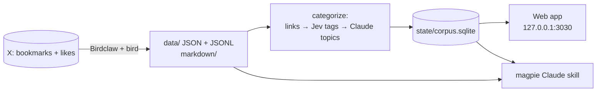

<div align="center">

<h1></h1>

**Every post you bookmarked or liked on X, archived on your machine, sorted into topics, and searchable by your coding agents.**


[Overview](#overview) •
[Quick start](#quick-start) •
[Get started with an agent](#get-started-with-an-agent) •
[Manual setup](#manual-setup) •
[Usage](#usage) •
[Commands](#commands) •
[Project layout](#project-layout)

</div>

## Overview

You save good posts on X and never see them again. Magpie keeps a local copy of all of them and makes them useful:

- **Self-updating archive.** A background worker syncs your bookmarks and likes every 3 hours and catches up after sleep.
- **Automatic categories.** Claude proposes areas and topics, Jev (TypeSafe) scores each post against each topic, and new topics appear as your saves grow. Every change is logged and can be undone.
- **A web screen.** Filter by category, collection, author, keyword, time range and media. Ask a question in plain words, browse the repos and pages your posts link to, and fix categories by hand.
- **A Claude skill.** Your agents can search what you already vouched for ("what have I saved about scroll animations?") and cite the post.
- **Local by default.** The corpus, the store and the web app stay on your machine. The app listens on `127.0.0.1` only.



> [!CAUTION]
> Birdclaw syncs with your X browser session cookies (`auth_token` and `ct0`). X's terms do not allow this, and X could limit or suspend your account. The cookies give full access to your account, so treat them like a password. By connecting X you accept that risk.

## Quick start

You need macOS or Linux and [Bun](https://bun.sh). Setup finds Node 26 for you, or tells you how to install it.

```bash
git clone https://github.com/ianpoley/magpie.git
cd magpie
bun run setup
```

`setup` installs the dependencies, checks the machine, and walks you through each step that is not done yet. It asks before each one:

1. Install the background services: the sync worker and the web app on http://127.0.0.1:3030.
2. Connect X: it opens the web app, where you paste your X cookies into the **Connect X** dialog.
3. Paste your Jev (TypeSafe) key. Magpie needs it, and typing is hidden. Skip it here and the web app asks for it before it shows anything.
4. Optional: link the Claude skill, so your agents can search your saved posts.
5. If you moved off the old nightly job: delete the logs it left in `logs/`, about 25 MB a night.

It ends with what is running and what is left. Run it again at any time: it skips what is done, so on a machine that is set up it asks nothing.

## Get started with an agent

You can also let a coding agent such as Claude Code do the setup. Clone the repo, open your agent in the clone, and paste one of the prompts below.

```bash
git clone https://github.com/ianpoley/magpie.git
cd magpie
claude
```

> [!IMPORTANT]
> Never paste your X cookies or your Jev key into the agent chat. You enter both in the web app's setup screen, or the Jev key in your own terminal. The prompts below tell the agent to stop and hand those steps to you.

### Prompt: set up Magpie on this machine

```text
Set up Magpie on this machine. Read README.md and packages/engine/SETUP.md first.

1. Check that Bun is installed. If it is missing, tell me how to install it and wait.
   Do not install global npm packages or Homebrew formulas: Birdclaw and bird are
   repo dependencies, and setup finds Node 26 itself or says how to install it.
2. Run `bun run setup --yes`. Without a terminal it never prompts: it installs the
   background services and links the Claude skill, and stops at anything that holds
   a secret or would replace something (services installed from another clone, a
   skill linked elsewhere). Fix what you can and explain what you can't.
3. If it lists services from another clone or a skill linked elsewhere, stop and
   ask me before doing anything about it.
4. Do not ask for, read, or handle my X cookies or my Jev key. Tell me to run
   `bun run setup` myself in a terminal: it opens the web app's setup screen, reads the
   Jev key with echo off, and skips everything already done.

End with setup's "Still to do" list and a short summary: what is running, on which
port, and what I still need to do.
```

### Prompt: get oriented before changing the code

```text
I want to work on Magpie. Before you change anything, get oriented:

- Read README.md, CONCEPTS.md (domain vocabulary), packages/engine/README.md,
  apps/web/README.md, apps/web/AGENTS.md and apps/web/DESIGN.md.
- Skim docs/solutions/: past problems and the decisions they led to.
- Note the rules: the web app loads engine code only through
  apps/web/src/lib/engine.ts; UI is built from @ui-sdk/react with Grove tokens;
  read the Next.js docs bundled in node_modules before using a Next.js API.
- Do not start a second `next dev` in apps/web if one is already running.
- Never touch state/corpus.sqlite directly: it holds my edits and can't be rebuilt.

Then summarize how a sync flows from X to the web screen, list the checks to run
before a change is done (lint, typecheck, test, build), and wait for my task.
```

### Prompt: draw on your saved posts

Once the skill is installed, use it from any project:

```text
Use the magpie skill. Run `categories`, find the topics that fit what we are
building, and pull the most relevant posts and resources. Suggest 3 concrete ideas
for this feature, and cite each one with the @handle and post URL.
```

## Manual setup

### Prerequisites

- macOS or Linux
- [Node](https://nodejs.org) 26 (`.node-version`; supported range `>=25.8.1 <27`). `bun run setup` finds one even when nvm or another version manager puts an older Node first on your `PATH`, and installs the services with it. If you run `service:install` by hand, switch first: the services keep the Node they were installed with.
- [Bun](https://bun.sh) 1.3
- A Jev (TypeSafe) API key
- Optional, for categories: the [Claude Code CLI](https://claude.com/claude-code), installed and logged in
- On Linux: libsecret's `secret-tool` and a running Secret Service, or secrets fall back to an owner-only file

### Install

`bun run setup` does all of this for you (see [Quick start](#quick-start)). By hand:

```bash
bun install
bun run setup --yes       # checks the machine, installs the services and links the skill; never prompts
bun run service:install   # or just this: builds the web app, installs the magpie-web and magpie-worker services
bun run service:status
```

The services are LaunchAgents on macOS and `systemd --user` units on Linux. They start at login and restart on failure.

### Connect X and add your Jev key

Open http://127.0.0.1:3030. Until both are saved, it shows only the setup screen, in two steps:

1. **Connect X:** paste your `auth_token` and `ct0` cookies from the browser's dev tools (Application, Cookies, x.com).
2. **Jev key:** paste your Jev (TypeSafe) API key. To store it from a terminal instead, run `bun run secrets:set-jev` (typed hidden).

Each value is checked before it's saved. The first sync starts once both are saved, and **Sync now** runs another at any time.

### Optional extras

```bash
bash packages/skill/install.sh   # links the Claude skill into ~/.claude/skills
```

Without the Claude CLI, the sync and export still work and categorization is skipped. The first categorize run takes several minutes; later runs only handle new posts.

### Update or remove

```bash
git pull
bun run service:install          # rebuilds and restarts both services
bun run service:status

bun run service:uninstall                     # remove the services
bun run service:uninstall -- --purge-secrets  # also delete the cookies and Jev key, and disconnect X
```

> [!NOTE]
> With Homebrew's Node, the services run it through `/opt/homebrew/opt/node`, so `brew upgrade` keeps them running. With another version manager, if the old Node path disappears the services stay stopped until you rerun `bun run service:install`. `service:status` tells you when this happens.

## Usage

### Web app

The installed service runs at http://127.0.0.1:3030 (`MAGPIE_PORT` overrides it). Highlights:

- Filter by area and topic, collection, author, keyword, time range and media. Filters live in the URL, so you can bookmark them.
- **Ask** judges every post against a question. **Pin** saves it as a search that later syncs keep up to date.
- **Resources** lists the repos, packages, videos and pages your posts link to, most saved first.
- Rename, merge, hide or delete topics. Remove a post from the corpus without touching X.
- Keyboard: `/` to search, `j` and `k` to move between cards, Enter to open one.

See [apps/web/README.md](apps/web/README.md) for the full tour.

### Claude skill

After `bash packages/skill/install.sh`, agents can query the corpus directly:

```bash
node ~/.claude/skills/magpie/query.mjs categories
node ~/.claude/skills/magpie/query.mjs topic "<area or topic>" --limit 8
node ~/.claude/skills/magpie/query.mjs resources "<area or topic>"
node ~/.claude/skills/magpie/query.mjs "state machine" --source bookmarks --json
```

The skill is a symlink to `packages/skill/` and finds this clone from its own real path. See [packages/skill/SKILL.md](packages/skill/SKILL.md).

### Raw files

Every sync writes plain files you can read from any tool:

| Path | What it holds |
|---|---|
| `data/{bookmarks,likes}.normalized.jsonl` | One `{type,id,handle,name,created,url,text}` record per line |
| `markdown/{bookmarks,likes}/` | One `.md` per post with YAML frontmatter, plus `index.md` |
| `state/corpus.sqlite` | Categories, tags, links, your edits and the change log |

> [!WARNING]
> `state/corpus.sqlite` is the one file that cannot be rebuilt from X. It holds your category edits, per-post fixes, removed posts and the change log. Back it up.

## Things to know

- **Secrets and services are per user, data is per clone.** The cookies, the Jev key and the connection live in the macOS Keychain or Linux Secret Service (service `magpie`) and in `~/.config/magpie`. The corpus lives in each clone. Connecting X from another clone or worktree replaces the cookies the installed service uses, and running `service:install` from another clone points both services at that clone.
- **Worktrees share the main checkout's corpus.** A linked git worktree reads `data/`, `state/` and `logs/` from its main checkout, so a dev server in a worktree shows your real posts and the real worker's status. Edits you make there change your real store. A worktree never upgrades that store's schema: a branch with a store migration needs `MAGPIE_ROOT` pointed at a copy. `setup` and `service:install` refuse to install services from a worktree and name the main checkout instead. `MAGPIE_ROOT` overrides the data root.
- **No sign-in.** The web app answers loopback requests only and has no login. That assumes only you have a login on the machine.
- **Ports.** The service uses 3030. `bun run dev` uses 3000, so a dev server never collides with it.
- **Sync interval.** Set `SYNC_INTERVAL_HOURS` in `~/.config/magpie/settings.env` (default 3).
- **Secret fallback.** With no usable keychain, secrets go to an owner-only `~/.config/magpie/secrets.env`, and the app shows a warning.
- **History fills in over time.** The first sync of each collection backfills its full history. X rate-limits the likes endpoint, so likes may arrive across several syncs.
- **What leaves the machine.** Browsing sends nothing. Ask mode and tagging send post text to Jev, category upkeep sends it to Claude through your Claude Code CLI login, and the links stage requests each linked URL once to read its title.

## Commands

Run from the repo root:

```bash
bun run setup            # first run: install deps, check the machine, walk through what is left (--yes: no prompts)
bun run service:install  # build, then install or update both services
bun run service:status
bun run service:uninstall
bun run secrets:set-jev  # store the Jev key
bun run sync             # run one whole sync now
bun run categorize       # categorize only
bun run build:markdown   # rebuild markdown/ and jsonl from existing data/*.json
bun run dev              # web app on http://127.0.0.1:3000
bun run build            # production build of the web app
bun run lint
bun run typecheck
bun run test             # node --test across engine, skill and web
```

## Project layout

```
apps/web/         # @magpie/web: the Next.js corpus screen
packages/engine/  # @magpie/engine: sync, export, categorize, worker, service installer
packages/skill/   # the magpie Claude skill (symlinked into ~/.claude/skills)
docs/plans/       # implementation plans
docs/solutions/   # solved problems and tooling decisions
data/             # generated: raw JSON + normalized JSONL   (gitignored)
markdown/         # generated: one .md per post              (gitignored)
state/            # corpus.sqlite: your edits live here      (gitignored, not regenerated)
logs/             # sync and service logs                    (gitignored)
```

| Read next | For |
|---|---|
| [CONCEPTS.md](CONCEPTS.md) | Domain vocabulary: X session, secret backend, worker, run lock |
| [packages/engine/README.md](packages/engine/README.md) | Sync pipeline, categorization stages, output formats |
| [packages/engine/SETUP.md](packages/engine/SETUP.md) | Step-by-step setup and update |
| [apps/web/README.md](apps/web/README.md) | Everything on the screen, code layout, checks |
| [apps/web/AGENTS.md](apps/web/AGENTS.md) and [DESIGN.md](apps/web/DESIGN.md) | Framework, component and design-system rules |
