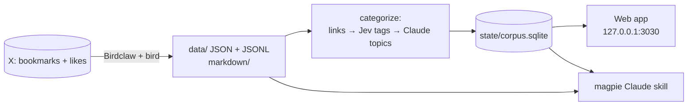
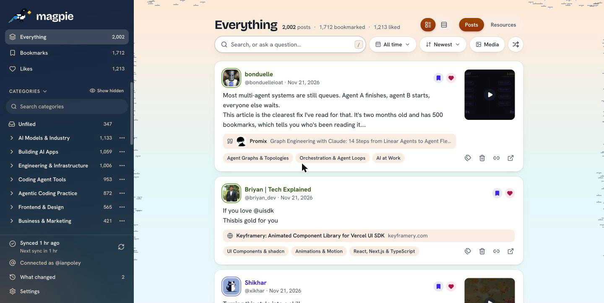
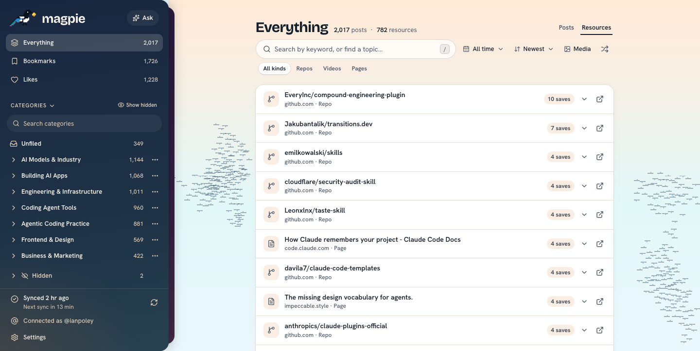

<div align="center">

<h1></h1>

**Every post you bookmarked or liked on X, archived on your machine, sorted into topics, and searchable by your coding agents.**


[What it does](#what-it-does) •
[Screenshots](#screenshots) •
[Use it from Claude Code](#use-it-from-claude-code) •
[What you need](#what-you-need) •
[Install](#install) •
[More docs](#more-docs)

</div>

## What it does

You save good posts on X and then never find them again. Magpie keeps a copy of every bookmark and like on your machine and sorts them so you can use them.

- A background worker syncs your bookmarks and likes every 3 hours. After the machine sleeps, it catches up.
- Claude proposes areas and topics, and Jev (TypeSafe) scores each post against each topic. New topics appear as you save more. Magpie logs every change.
- A web app lets you filter by category, collection, author, keyword, time range and media. You can ask a question in plain words and get a written answer that cites your posts, browse the repos and pages your posts link to, and fix categories by hand.
- A Claude skill lets your agents search the posts you saved ("what have I saved about scroll animations?") and cite them.
- The corpus, the store and the web app stay on your machine. The app listens on `127.0.0.1` only.



## Screenshots

Your saved posts, with categories in the sidebar and filters above the list:



The repos, videos and pages your posts link to, most saved first:



## Use it from Claude Code

The magpie skill gives Claude Code your saved posts as a source. Ask in plain words, from any project:

- "What have I saved about scroll animations?"
- "Use my bookmarks to suggest three ideas for this onboarding flow."
- "Which libraries do my saved posts keep linking to for auth?"

Claude searches your corpus by topic or keyword and answers with the posts it used. Each idea cites the `@handle` and the post URL, so you can open the source. Claude also uses the skill without being asked when a task matches a topic you saved.

The skill reads the files on your machine and changes nothing. It leaves out the areas you hid and the posts you removed in the web app. Setup links the skill in step 4. Read [docs/usage.md](docs/usage.md#claude-skill) for more. If Magpie runs on another machine, connect Claude Code to the app's MCP endpoint instead: see [docs/usage.md](docs/usage.md#mcp-server-use-your-corpus-from-another-machine).

## What you need

| Service or tool | Required? | What Magpie uses it for |
|---|---|---|
| An X account, signed in on a browser | Required | Magpie reads your bookmarks and likes with its session cookies (`auth_token`, `ct0`). Read the caution below. |
| A [Jev (TypeSafe)](https://docs.typesafe.ai) API key | Required | Jev scores each post against each topic, and reads every post for **Find topic** and **Ask**. The web app shows nothing until you save the key. |
| [Claude Code CLI](https://claude.com/claude-code), installed and logged in | Optional | Claude proposes and updates the categories, and writes the answer to each **Ask**, with the model and effort you pick in Settings (Opus 5.5 at medium effort until you change them). The calls count against your Claude plan's usage. Without it, sync and search still work, but Magpie creates no categories and an Ask lists its matches with no written answer. |
| macOS or Linux | Required | The background services run as LaunchAgents or `systemd --user` units. |
| git, [Bun](https://bun.sh) 1.3 and [Node](https://nodejs.org) 26 | Required | Bun runs setup and the scripts. The installer adds Bun if you don't have it; on Linux, Bun's installer needs `unzip`. Setup finds Node 26 even when another Node is first on your PATH, or tells you how to install it. |

Some data leaves your machine. Magpie sends post text to Jev for tagging and Ask, and to Claude through your CLI login for categories and for Ask answers. It requests each page your posts link to once, to read its title. Browsing sends nothing.

> [!CAUTION]
> Birdclaw syncs with your X browser session cookies (`auth_token` and `ct0`). X's terms do not allow this, and X could limit or suspend your account. The cookies give full access to your account, so treat them like a password. When you connect X, you accept that risk.

## Install

Paste this into a terminal on macOS or Linux:

```bash
curl -fsSL https://raw.githubusercontent.com/ianpoley/magpie/main/install.sh | bash
```

The installer adds [Bun](https://bun.sh) to `~/.bun` if you don't have it. It downloads Magpie into `~/magpie` (set `MAGPIE_DIR` to pick another folder) and starts `bun run setup`.

Setup installs the dependencies and checks the machine. Then it asks before each step that is not done yet:

1. Install the background services: the sync worker, and the web app on http://127.0.0.1:3030.
2. Connect X. Setup opens the web app, and you paste your X cookies into the **Connect X** dialog.
3. Paste your Jev (TypeSafe) key. Setup hides what you type. If you skip this step, the web app asks for the key before it shows anything.
4. Optional: link the Claude skill, so your agents can search your saved posts.

At the end, setup lists what is running and what is left to do. You can run the same command again at any time. It updates the code, skips the steps that are done, and offers to rebuild the services if the code changed.

If you already have a clone, run `bun run setup` in it:

```bash
git clone https://github.com/ianpoley/magpie.git
cd magpie
bun run setup
```

To install each part by hand, update, or remove Magpie, read [packages/engine/SETUP.md](packages/engine/SETUP.md).

### Install with a coding agent

A coding agent such as Claude Code can also run the install. Open the agent in any folder and paste the setup prompt from [docs/agents.md](docs/agents.md). That file also has prompts for working on the code and for using your saved posts in other projects.

> [!IMPORTANT]
> Never paste your X cookies or your Jev key into an agent chat. Enter both in the web app's setup screen, or enter the Jev key in your own terminal.

## More docs

| Read | For |
|---|---|
| [docs/usage.md](docs/usage.md) | The web app, the Claude skill, the raw files, commands and things to know |
| [docs/agents.md](docs/agents.md) | Prompts to paste into a coding agent |
| [docs/development.md](docs/development.md) | Checks, project layout and where to read next |
| [packages/engine/SETUP.md](packages/engine/SETUP.md) | Each setup step by hand, update and remove |
