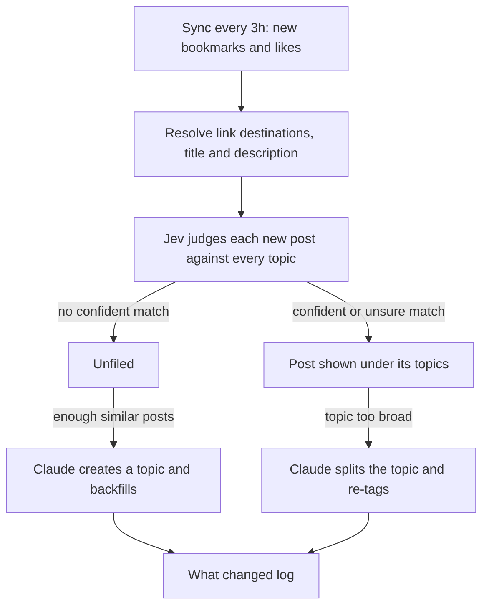
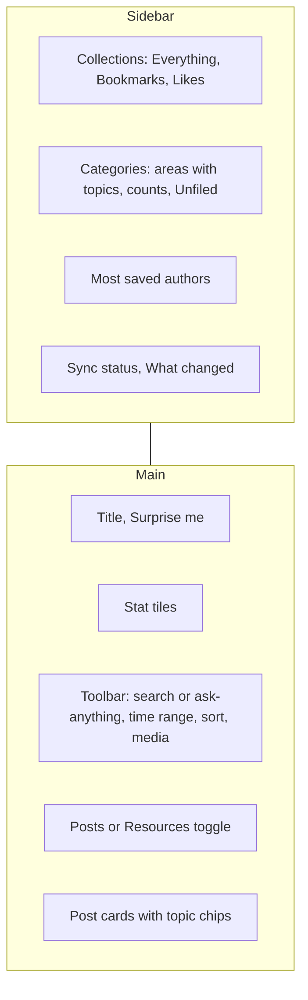
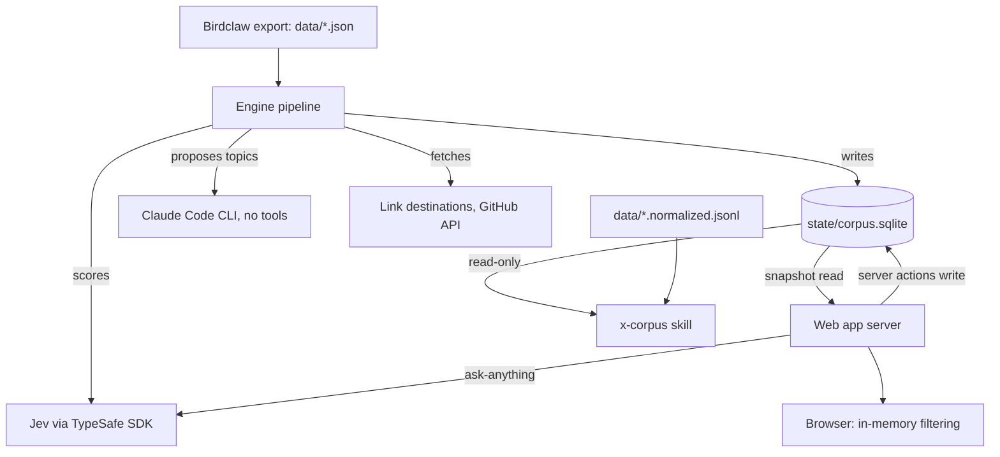
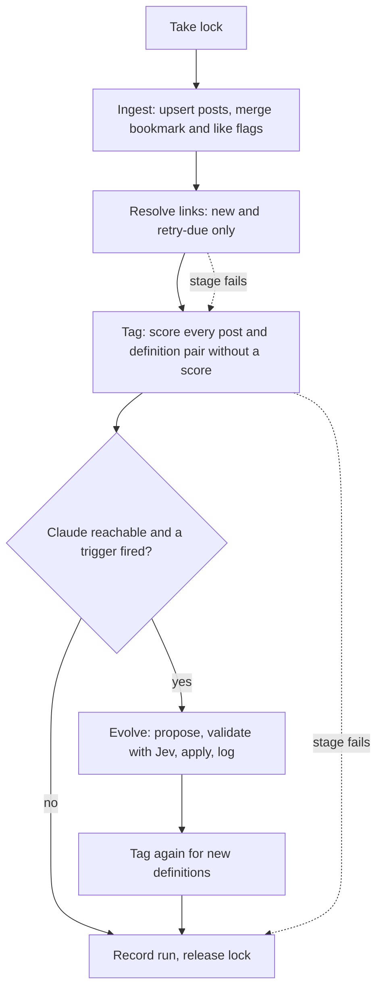
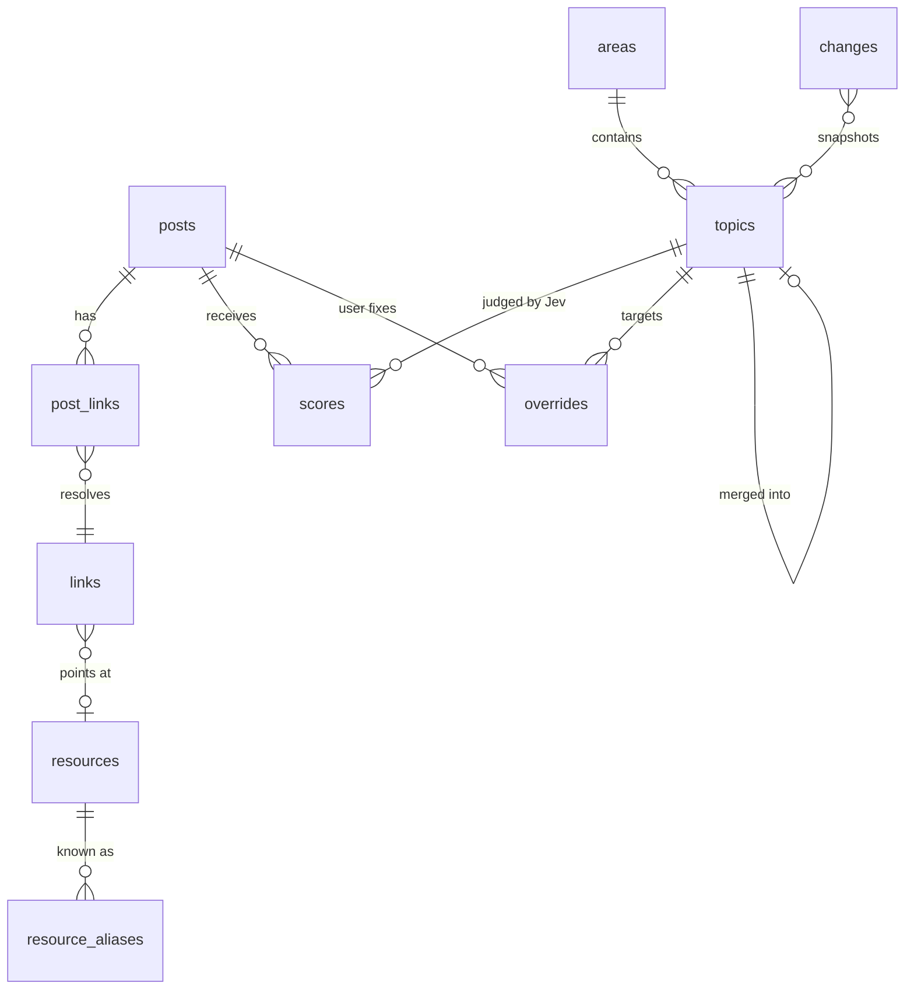
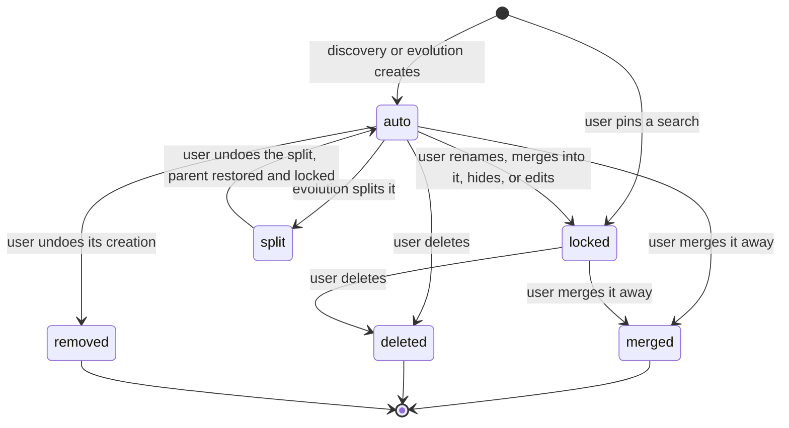

# Corpus Screen with Auto-Categories - Plan

## Goal Capsule

- **Objective:** The user can find any dev resource they saved on X by topic. They can browse categories that stay accurate without upkeep, or describe a topic in their own words. This works in the web app and through Claude.
- **Product authority:** The user is the sole user and decision-maker. The decisions below were made in dialogue on 2026-11-19 and govern this plan.
- **Means:** One local SQLite store that the sync job, the web app, and the skill all read; Jev scores posts against topics and Claude proposes the topics (KTD1, KTD4, KTD6).
- **Authority:** Product Contract requirements win on product behavior. Key Technical Decisions win on mechanism within the requirements they cite. A unit overrides neither.
- **Execution profile:** One pull request, twelve units in dependency order. The repo has no git remote, so the work ends as local commits unless one is added.
- **Stop conditions:** Stop and report when a session-settled Key Decision proves unworkable, when Jev or Claude cannot be reached with the credentials on this Mac, or when a change would alter the live 3-hourly sync before U12.
- **Finishing:** The implementer runs the first live backfill in U12 and confirms the screen against real data. launchd and the skill symlink both run from this working tree, so after U12 the checked-out branch is the live system. The user reviews the result and decides whether to add a remote.
- **Open blockers:** None.
- **Product Contract preservation:** Product Contract unchanged. The six questions deferred to planning are answered by KTD1–KTD15; Outstanding Questions now lists what is left for implementation and for the user.

---

## Product Contract

### Summary

Build the real corpus screen in `apps/web`, in the shape of the Grove prototype and covering every saved post. Add automatic two-level categories that Claude proposes and grows and that Jev applies to every post. Posts that fit nowhere go to a visible Unfiled pile. Users can also run "ask-anything" topic searches and pin them, and each category gets a Resources view that groups posts by the library, repo, or article they point at. The x-corpus Claude skill gets the same categories and resources.

### Problem Frame

The user bookmarks and likes dev resources on X: evals, UI components, animations, agents, and similar. That gives 2,281 unique posts from 1,364 authors, synced every 3 hours. Finding one later depends on remembering an exact keyword. That works neither by hand nor through the x-corpus skill, whose search only ranks keyword hits. There is also no way to see everything saved on a topic.

Many posts are a short line plus a `t.co` link, so the meaning lives at the link's destination, and the export doesn't contain it. Folders or manual tags would fix discoverability, but the user doesn't want upkeep. They will stop trusting the system the moment a recent save is missing from the category it plainly belongs to.

### Key Decisions

- **Auto-discovered categories, not a user-written list.** The user should never have to curate; they can still edit anything. Governs R5, R11, R12. (session-settled: user-directed — chosen over a user-seeded list, a fixed curated list, and free-form per-post tags: hands-off upkeep without tag sprawl.)
- **Two levels: areas containing topics.** Filtering works at either level and stays scannable as topics grow past 40–60. Governs R5, R6, R19. (session-settled: user-directed — chosen over flat topics and over topics plus a resource-type facet.)
- **Jev tags posts; Claude names and maintains categories.** Jev gives a calibrated probability per topic, so the unsure band is real and thresholds can be tuned. It's also cheap: about $0.30 per full pass. Jev can't generate category names, so Claude does discovery and evolution. Governs R7, R9, R11, R12, R21. (session-settled: user-directed — chosen over Claude doing both: Jev's tagging is cheaper and more tunable; the cost is a second credential.)
- **Gap-driven evolution plus ask-anything.** The category list changes when the corpus demands it: an Unfiled pile fills, or a topic grows too broad. It doesn't change on a schedule. Free-text topic search covers queries narrower than any category. Governs R10–R12, R21, R22. (session-settled: user-directed — chosen over a weekly scheduled review and over gap-driven alone.)
- **Automatic changes apply immediately and are logged, not queued for approval.** Governs R11–R14. (session-settled: user-directed — chosen over a review queue and over add-only evolution.)
- **User edits always win.** Automatic restructuring never undoes anything the user touched. Governs R16. (session-settled: user-directed — chosen over letting the system re-propose changes later.)
- **Tune for recall over precision.** A missing post breaks trust faster than an extra one. Governs R9.
- **Multi-topic filters narrow (AND).** Matches drilling into a topic, which is how the user browses. Governs R19. (session-settled: user-directed — chosen over OR and over a match-all/match-any toggle.)
- **Resources are a first-class view.** The user's stated need is "what resources I have for a topic"; a resource is the thing a post points at, not the post itself. Governs R23–R25. (session-settled: user-approved — proposed as an addition with its cost shown; the user confirmed it into scope.)
- **Categories reach Claude too.** The keyword problem exists in the skill as much as in the UI. Governs R26, R27. (session-settled: user-directed — chosen over web-only for now.)
- **Grove design system and UI SDK components.** The screen follows `apps/web/DESIGN.md` and uses UI SDK wherever a component fits, per `apps/web/AGENTS.md`. Governs R2. (session-settled: user-directed — Grove chosen over Citrus, Lagoon, Riso, Spectrum, Ultraviolet, Tidepool, and Sunset in two prototype rounds.)

### Requirements

**Corpus screen**

- R1. The screen covers every saved post, with bookmarks and likes merged into one entry per post. It is not limited to a recent slice.
- R2. The screen keeps the Grove prototype's layout:
  - a sidebar with collections, most-saved authors, the category tree, and sync status;
  - a main column with title, stat tiles, toolbar (search, time range, sort, media toggle), post cards, and a post dialog;
  - copy-link and open-on-X actions;
  - designed empty states.
- R3. Keyword search matches post text, quoted-post text, author name and handle, and the title of each post's linked page. Matches are highlighted.
- R4. Each post card shows its topics as chips, and clicking a chip filters to that topic.

**Categories and tagging**

- R5. Categories have two levels: areas (e.g. AI, Frontend) containing topics (e.g. Evals, Animations). Claude proposes them from the corpus, and every topic carries a one-line definition.
- R6. A post can belong to any number of topics. It belongs to an area when it belongs to any topic in that area.
- R7. Every post is tagged. A newly synced post is tagged in the same sync that brings it in.
- R8. Tagging judges the post's text, its quoted post, and the title and description of each linked page. Link destinations are resolved from their `t.co` short links first.
- R9. A topic's posts include both confident and unsure matches. Unsure matches rank after confident ones, and posts judged a clear no are excluded.
- R10. A post with no confident match to any topic appears under an Unfiled filter until a topic claims it.

**Category evolution**

- R11. When enough similar posts collect in Unfiled, a new topic is created automatically, plus an area if none fits. All posts are then re-checked against it.
- R12. When a topic grows too broad to be useful, it is split automatically and its posts are re-tagged into the new topics.
- R13. Every automatic change (new topic, new area, split) is recorded in a "What changed" log with its date and the number of posts affected. The log is opt-in viewing and never sends notifications.
- R14. The user can undo any automatic change from the "What changed" log.

**User control**

- R15. The user can rename, merge, delete, and hide topics and areas.
- R16. Automatic restructuring never alters anything the user created or edited: renamed, merged, deleted, or hidden categories, pinned searches (R22), and per-post fixes (R17). New posts can still be tagged into user-edited topics.
- R17. From a post's card or dialog, the user can add or remove topics on that post, and the fix survives every later re-tag.
- R18. The user chooses which areas are hidden by default; non-dev areas (e.g. politics) start that way. Hidden areas stay out of the Everything view and out of skill results unless asked for. One control reveals everything.

**Filtering**

- R19. Selecting several topics shows posts in all of them. Selecting an area counts as selecting any topic inside it.
- R20. Category filters combine with collection (Everything, Bookmarks, Likes), author, keyword search, time range, sort, and the media toggle.

**Ask-anything topics**

- R21. The user can type any topic in their own words and see every saved post judged for relevance by meaning, ranked, within a few seconds.
- R22. The user can pin an ask-anything query as a topic. From then on, new posts are tagged against it like any other topic.

**Resources**

- R23. Each post is resolved to the resources it links to, such as a repo, package, article, tool, or video. Posts pointing at the same resource are grouped together.
- R24. Under any category or area filter, a Resources view lists the matching resources ranked by how many saved posts mention each. Each resource expands to those posts.
- R25. Posts without a link to a resource remain visible as posts and don't appear in the Resources view.

**Claude skill**

- R26. The x-corpus skill can list areas and topics with counts, return the posts in a category, and return a category's resources. It respects hidden-by-default areas unless asked. It cannot edit categories.
- R27. The skill's existing keyword search keeps working unchanged alongside category queries.

### Key Flows



- F1. Sync and evolve
  - **Trigger:** The 3-hourly sync brings in new posts.
  - **Steps:** Resolve each post's link destinations; tag it against every topic, including pinned searches; route posts with no confident match to Unfiled; when Unfiled or a topic crosses its threshold, create or split topics, backfill, and log the change.
  - **Outcome:** New saves appear under their topics in the same sync.
  - **Covered by:** R7–R14, R16, R22
- F2. Browse a topic
  - **Trigger:** The user picks Frontend › Animations in the sidebar.
  - **Steps:** The posts view shows confident matches first, then unsure ones. The user switches to Resources to see libraries and articles ranked by save count, then adds a second topic to narrow.
  - **Covered by:** R9, R19, R20, R24
- F3. Ask anything and pin
  - **Trigger:** The user types "evals for agents".
  - **Steps:** Results rank by judged relevance within seconds. The user pins the query, it appears as a topic, and it tags future posts.
  - **Covered by:** R21, R22, R16
- F4. Correct a post
  - **Trigger:** The user sees a post missing a topic it belongs to.
  - **Steps:** The user adds the topic from the card. The fix holds through later syncs and restructuring.
  - **Covered by:** R17, R16

Screen layout, for orientation:



### Acceptance Examples

- AE1. **Covers R8.** **Given** a post whose text is only "this is wild 🔥 https://t.co/abc" and whose link resolves to a GitHub repo for a React animation library, **then** the post is tagged Frontend › Animations.
- AE2. **Covers R9.** **Given** a post Jev rates as an unsure match for Evals, **when** the user filters to Evals, **then** the post appears after every confident Evals match.
- AE3. **Covers R11, R13, R14.** **Given** several new posts about a newly released tool that fit no topic, **when** enough of them collect in Unfiled, **then** a topic for that tool's subject is created and those posts move into it, and "What changed" lists the change with a post count. Undoing the change returns them to Unfiled.
- AE4. **Covers R16.** **Given** the user merged Agents into AI tooling, **when** the corpus later suggests splitting them, **then** no split happens and AI tooling keeps both sets of posts.
- AE5. **Covers R17, R16.** **Given** the user removed Animations from a post, **when** a later sync re-tags the corpus, **then** that post still lacks Animations.
- AE6. **Covers R19.** **Given** the user selects Evals and Agents, **then** only posts tagged with both appear. Selecting the AI area instead shows posts in any AI topic.
- AE7. **Covers R18, R26.** **Given** the Politics area is hidden by default, **then** its posts are absent from Everything and from skill results. Asking the skill for politics posts explicitly returns them.
- AE8. **Covers R22.** **Given** the user pinned "scroll-driven animation", **when** a new post about CSS scroll timelines syncs, **then** it appears under that pinned topic.
- AE9. **Covers R23, R24.** **Given** four saved posts link to the same animation library's site or repo, **then** under Frontend › Animations › Resources that library appears once, marked as 4 saves, and expands to the four posts.

### Success Criteria

- A dev post the user saved recently is found under the topic they'd expect, in the sync after it was saved. This is the signal the user said would break their trust if it failed.
- Asking Claude for a topic surfaces relevant saves that keyword search alone would miss.
- Unfiled stays small relative to the corpus, and most of the time the user never needs to edit categories.

### Scope Boundaries

Deferred for later:

- Using post images in tagging (Jev image support is experimental, PNG/JPEG only).
- A resource-type facet such as library vs thread vs demo.
- Dark mode (see `apps/web/DESIGN.md` known gaps).
- Editing categories through Claude; the skill stays read-only (R26).
- Ask-anything topic search inside the Claude skill, since Claude can already read posts itself.
- Notifications for automatic changes.
- Multiple X accounts or sharing the corpus with others.

Considered and not built:

- Scheduled backups of `state/corpus.sqlite`. Transactions and WAL cover crashes, and the file is local. A corrupted store or a wish to roll back user edits would change this.
- An authenticated GitHub API token for resource aliases. The unauthenticated limit fills aliases in over a few syncs. A corpus with thousands of distinct repos would change this.
- Merging resources across unrelated domains, such as a docs site the repo does not declare. It needs a judgment per pair; wrong merges are worse than missed ones.
- A virtualized post list. Paged rendering handles 2,281 posts; a corpus ten times larger would change this.
- Server-side filtering and pagination. In-memory filtering is instant at this size (KTD13).
- Undo for the user's own edits. R14 covers automatic changes only; delete and merge ask for confirmation instead. A mis-clicked merge the user cannot repair would change this.
- Moving a topic between areas, editing a definition, and unlocking a topic. R15 does not list them. A locked topic that grows too large with no way to split it would change this.
- Mapping an npm package to its repo. Only the GitHub homepage alias is built (KTD11).
- Filter state in the URL. No requirement asks for reloadable views; state lives in the client.
- A cap on automatic changes per run. Every change is logged and undoable, and a cap would delay R11 and R12.

### Dependencies / Assumptions

- The app runs locally on the user's Mac for a single user; no hosting or auth.
- The TypeSafe API key lives in `~/.config/x-corpus/secrets.env` as `TYPESAFE_API_KEY`, outside the repo; nothing loads it yet.
- Unattended Claude access is needed for discovery and evolution. It uses the user's Claude Code login (KTD4).
- The export doesn't resolve link destinations: of 4,476 URL entities, 4,472 have `expandedUrl` equal to the short `url`, including 2,663 `t.co` links. Birdclaw's `url_expansions` table holds only 3 demo rows. Link resolution (R8, R23) is new work.
- Jev answers typed judgments only and cannot name categories (TypeSafe docs, model jaggedness page). Post text is untrusted input that can try to steer answers.
- The sync job is `packages/engine/bin/birdclaw-nightly.sh`, run by launchd at 00, 03, … 21h. It sources `~/.birdclaw/bird.env`. Its outputs feed both the web app and the skill.

### Outstanding Questions

Deferred to implementation (none blocks the build):

- Does the headless Claude Code login work from launchd without a prompt? U12 proves it with a scheduled-job run. The fallback is a long-lived token from `claude setup-token` stored in `~/.config/x-corpus/secrets.env`, which needs the user (KTD4).
- What are this TypeSafe organization's rate limits? The docs publish none. U10 measures ask-anything latency and sets chunk size and concurrency from the result (KTD12).
- Do the starting evolution thresholds in KTD8 produce sensible topics on the real corpus? U12's backfill is the first evidence; the numbers live in one config module.

For the user, after the build (the plan proceeds on the stated default):

- R18 and R27 pull apart on the skill's keyword search. Should it drop hidden posts by default? The plan follows R18; `--include-hidden` restores them.
- The first discovery pass is logged as one "Initial categories" entry with no single undo. Any topic in it can still be deleted (R15). Is that enough for R14?

### Sources / Research

- `apps/web/DESIGN.md`: the Grove decision record and rules, plus the rejected directions.
- `apps/web/AGENTS.md`: the UI SDK usage rules and Grove token rules.
- `packages/engine/bin/birdclaw-nightly.sh`, `packages/engine/bin/build-markdown.mjs`: the current sync and export. The normalized record is `{type,id,handle,name,created,url,text}`.
- `~/.claude/skills/x-corpus/query.mjs` (machine-local, outside the repo): the current keyword-only skill. It reads `X_CORPUS_DIR`, defaulting to `~/x-corpus/data`.
- TypeSafe docs (https://docs.typesafe.ai/llms.txt):
  - the Noul and Choice primitives;
  - the fan-out pattern and the companion-Noul "none fit" pattern;
  - models and pricing ($0.042/Mtok input, 64k tokens/request);
  - the JS SDK `@typesafe-ai/sdk` (Node ≥ 22);
  - the Twitch chat filter cookbook, the closest multi-label example.
- Research added during planning:
  - TypeSafe docs, read 2026-11-19: `sdk/javascript`, `primitives/noul`, `patterns/fan-out`, `patterns/companion-noul`, `models`, `api/errors`, `cookbooks/parallel_questions`, `model-jaggedness`. Facts used: one request carries any number of questions within 64k tokens per request and 32k per question; a Noul returns P(yes) directly; most calls finish in about 100 ms; pricing is per input token; the SDK retries 408, 429, and 5xx twice by default with a 10 s timeout; rate limits are per organization and unpublished.
  - Local runtime, probed 2026-11-19: `/opt/homebrew/bin/node` is v26.5.0 and the nvm node is v24.17.0. Both load `node:sqlite` and run `.ts` files directly. Claude Code 2.1.328 is at `~/.local/bin/claude` and supports `--print`, `--tools ""`, `--json-schema`, and `--output-format json`. `TYPESAFE_API_KEY` is set in `~/.config/x-corpus/secrets.env`; no Anthropic API key exists on the machine.
  - Corpus shape, measured 2026-11-19: 2,281 unique posts, 943,721 characters of text, longest post 15,146 characters, 485 with a quoted post, 1,166 with media, 1,626 with at least one URL.
  - Next.js docs shipped in `apps/web/node_modules/next/dist/docs/01-app/01-getting-started/`: `08-caching.md`, `09-revalidating.md`, `07-mutating-data.md`.
  - UI SDK docs shipped in `apps/web/node_modules/@ui-sdk/react/docs/`: `llms.txt`, `server-rendering.md`, and `components/` (tree, segmented-control, dialog, drawer, menu, popover, toggle, switch, input, autocomplete, token-input, avatar, scroll-area, collapsible, tooltip, toast).

---

## Planning Contract

### Key Technical Decisions

- KTD1. **One SQLite file at `state/corpus.sqlite` is the single store, opened with Node's built-in `node:sqlite` in WAL mode.** It holds posts, link metadata, resources, areas, topics, Jev scores, user overrides, pinned searches, the change log, and run history. The sync job and the web app both write, so the store needs transactions and safe concurrent access, which JSON files do not give. `state/` is gitignored and separate from `data/`, because `data/` is regenerated every sync and this file holds the only irreplaceable state: user edits and the change log. `node:sqlite` adds no dependency and already loads under launchd's node, the web server's node, and the skill's node. A bake-off was not needed: JSON files fail the two-writer and undo requirements on inspection, and a client-server database adds a daemon for a single-user Mac app.
- KTD2. **The store schema is a versioned contract with one owner.** `packages/engine/src/store/schema.ts` creates and migrates it and writes `schema_version` to a `meta` table. The skill and the web app refuse to read a newer version than they know.
- KTD3. **New engine code is TypeScript that node runs directly, tested with `node --test`.** It uses only erasable syntax, so launchd's node needs no build step and no bun. The web app imports the same modules through `transpilePackages`. No test runner exists in the repo today; this adds one with no dependency. Jev, Claude, and HTTP sit behind injected interfaces so every unit verifies offline.
- KTD4. **Claude is reached through the headless Claude Code CLI at `~/.local/bin/claude`, using the user's existing login.** The call passes `--print`, `--tools ""`, `--strict-mcp-config` with no MCP config, `--safe-mode`, `--disable-slash-commands`, `--json-schema`, and `--no-session-persistence`. `--tools ""` removes only built-in tools; the other flags keep MCP servers, plugins, skills, hooks, and the user's CLAUDE.md out of the session, so the call can take no action. No Anthropic API key exists on the machine and discovery runs rarely, so a second paid credential buys nothing. A failed or missing CLI skips evolution for that run with a warning; tagging still completes. Instantiates the Key Decision that Jev tags and Claude names (R5, R11, R12). (session-settled: user-directed — chosen over Claude doing both: Jev's tagging is cheaper and more tunable; the cost is a second credential.)
- KTD5. **Post text and fetched page metadata are untrusted input.** Claude runs with no built-in tools, no MCP servers, and no user customizations (KTD4), and its output is accepted only when it validates against the JSON schema; names and definitions are length-capped and stripped of control characters and markup before storage. Nothing either model returns is executed or used as a path, URL, or SQL fragment. Jev answers are treated as data that an injected instruction may move; the stakes are a wrong tag that R17 lets the user fix.
- KTD6. **Jev scores each post with one request: the post is the state and each active topic definition is one Noul.** A Choice cannot serve because its probabilities sum to 1 and posts are multi-label (R6). The store keeps the raw probability per post and definition. Confident is ≥ 0.7, unsure is 0.3 to 0.7, and no is below 0.3; these two numbers live in one config module and apply at read time, so tuning them needs no re-tagging (R9). A post is scored against a definition only when no score exists for that pair, which makes tagging incremental and resumable (R7). The one exception: when a link resolves after its post was scored, that post's scores are cleared so it is scored again with the new metadata (KTD10). A post with a missing score, or with a link still due for retry, is pending: it is shown, but it is not evolution input (KTD8). All question wording lives in one module, `packages/engine/src/jev/questions.ts`.
- KTD7. **Topic membership is defined once, as a SQL view, and every reader uses it.** The view combines Jev scores, per-post overrides, merge redirects, deletions, and hidden flags into one row per post and topic with a `confident` or `unsure` band. The web app, the skill, and the evolution stage all query it, so the three surfaces cannot disagree about what a topic contains (R6, R9, R10, R16–R18, R26). The same module defines Unfiled and hidden, each once.
- KTD8. **Evolution is proposed by Claude and applied only when Jev's counts support it.** A new topic is proposed when Unfiled holds at least 25 posts not seen by an earlier proposal round; it is created when at least 8 Unfiled posts match it confidently. A topic is too broad when its confident posts exceed the larger of 120 and 8% of the corpus; a split applies when at least two proposed subtopics each hold 15 confident posts and together cover 80% of the parent. A round that creates nothing is recorded, and the trigger waits until the pile grows by a quarter. A round that creates a topic runs again in the same run while 25 eligible Unfiled posts remain, so a large first backlog drains. All numbers live in one config module. Four rules keep evolution safe:
  - **Score first, then swap.** Proposed topics are scored against the affected posts while still inactive. One transaction then re-checks locks and tombstones, activates the new topics, retires a split parent, and writes the change-log row with its snapshot and post count. A crash before that transaction leaves the list as it was.
  - **No post loses its place in a split.** A parent post that no subtopic claims stays attached to the subtopic it scored highest on, as unsure.
  - **Deleted and undone topics do not grow back under another name.** Tombstones and suppressed proposals keep their last confident match set. A proposal whose confident matches overlap one by more than half is rejected (R16).
  Undo restores the snapshot (R14) and is offered for every logged change. When later automatic changes touched the same topics, undoing the older change undoes those too, newest first, and the confirmation lists them. Posts synced since the change are scored against the restored topic by the next tagging pass. Instantiates gap-driven evolution with immediate, logged changes (R11–R14). (session-settled: user-directed — chosen over a weekly scheduled review, and over a review queue: the list changes when the corpus demands it and the user never has to approve.)
- KTD9. **The first discovery pass aims for 6 to 9 areas and 30 to 50 topics, built in two steps.** Claude reads the corpus in batches of about 300 truncated posts and proposes candidate topics per batch; a final call merges the candidates into one two-level list with a one-line definition per topic and a `dev` flag per area. Non-dev areas start hidden (R5, R18). The whole corpus does not fit one call reliably, and the Unfiled loop in KTD8 fills whatever the first pass misses. The first pass is logged as one "Initial categories" entry that cannot be undone as a unit.
- KTD10. **Links are resolved once and cached.** Each `t.co` link is followed to its final URL with a redirect cap, an 8 s timeout, and at most 8 requests in flight; the page's title and description are read from the first 256 KB of HTML. Links that end on `x.com` or `twitter.com` are recorded as not a resource and not fetched further. A failed link is retried on later syncs, up to 4 attempts with a growing gap, then left as unresolved. A page whose title matches a bot-wall or login pattern is stored as unresolved, so "Just a moment..." never becomes a title. A post is tagged with whatever metadata exists at the time and re-scored once when a link of its resolves later (R8).
- KTD11. **A resource is identified by a canonical key derived from the final URL.** GitHub URLs reduce to `github:owner/repo`, npm to `npm:package`, YouTube to `youtube:id`, and anything else to host plus path with tracking parameters, fragment, `www.`, and trailing slash removed. A host is aliased to a GitHub repo, so a library's site and its repo group together, only when three things hold: the host is the declared homepage of exactly one repo in the corpus, the homepage path is the root, and the host is not on a shared-host list such as `github.io`, `vercel.com`, `medium.com`, `substack.com`, `youtube.com`, or `npmjs.com`. Every path on an aliased host then maps to the repo (R23, AE9). The homepage lookup uses GitHub's unauthenticated API, is cached, and fills in across syncs when rate-limited.
- KTD12. **Ask-anything runs on the web server and fans one question out over every post in chunked requests.** Each request carries about 40 questions, one per post, and requests run in parallel. Each question carries the same post content the tagger uses, built by the same module: text, quoted text, and each resolved link's title, description, and host, truncated to the ask limit. Results stream to the screen as chunks return, ranked by probability with the KTD6 bands (R21). The server reads `TYPESAFE_API_KEY` from `~/.config/x-corpus/secrets.env`; the key never reaches the browser. A new query cancels the one in flight. Pinning stores the query as a locked topic together with the scores just computed, and later syncs score new posts against it like any other topic (R22).
- KTD13. **The web app sends the whole visible corpus to the browser once and filters in memory.** 2,281 posts are about 1 MB, and every filter in R19 and R20 then responds without a round trip. The snapshot loader calls `connection()` from `next/server` before opening the store and renders inside a Suspense boundary. `node:sqlite` is synchronous, so without `connection()` the read would be prerendered at build time under `cacheComponents: true` (`08-caching.md`). The web server binds to loopback only: the `dev` and `start` scripts pass `-H 127.0.0.1`, because the app has no auth and its server actions edit the store. Writes go through server actions that update the store and refresh the route. The list renders in pages of about 60 cards. The sync job cannot notify the web server, so the screen refreshes its snapshot when the window regains focus.
- KTD14. **The skill's source moves into the repo at `packages/skill/` and is installed as a symlink at `~/.claude/skills/x-corpus`.** Today it lives only outside the repo, so changes to it appear in no diff. It stays dependency-free: category commands read the store through `node:sqlite` in read-only mode, and the keyword path keeps reading the normalized JSONL unchanged (R26, R27).
- KTD15. **The live 3-hourly job is not touched until the last unit.** launchd runs `packages/engine/bin/birdclaw-nightly.sh` from this working tree on every branch. New stages live in a separate entry point that the nightly script calls last, behind the script's existing `|| echo WARN` pattern, so a failure in the new stages never blocks the export. A lock file prevents a manual run and a scheduled run from overlapping.

### High-Level Technical Design

Components and who reads or writes the store:



Pipeline stages and failure isolation. Each stage commits its own work, so a later failure loses nothing earlier:



Store shape:



Topic lifecycle. Any user edit moves a topic to `locked`, and nothing automatic leaves that state:



Membership rules the KTD7 view implements, first matching row wins:

| Post and topic state | In topic? | Band |
|---|---|---|
| User removed the topic from the post | No | — |
| User added the topic to the post | Yes | confident |
| Topic deleted | No | — |
| Topic merged away | Counts for the surviving topic | by score |
| Score ≥ 0.7 | Yes | confident |
| Score 0.3 to 0.7 | Yes | unsure |
| Score below 0.3, or no score | No | — |

### Assumptions

These are bets the Product Contract does not settle. Each is reversible in one module.

- A post is hidden when its best match, confident or unsure, is in a hidden area or hidden topic and it has no confident match in a visible topic. Hiding applies to Everything, Bookmarks, Likes, keyword search, stat tiles, most-saved authors, ask-anything results, Resources, and Surprise me (R18, AE7).
- R18 and R27 pull apart on the skill's keyword search: today it reads only the JSONL and would return hidden posts. This plan follows R18. Keyword search drops hidden posts when the store exists, `--include-hidden` restores them, and the output format does not change.
- A post with only unsure matches appears both under those topics and under Unfiled (R9, R10).
- Selecting Unfiled clears any topic selection. Explicitly selecting a hidden area or topic shows its posts without the reveal-all control (R18, R19).
- An area selected together with one of its own topics reduces to the topic. Unsure matches count toward a multi-topic selection (R19).
- Clicking a chip replaces the category selection with that topic. Chips show a post's confident topics, plus the filtered topic in a muted "possible" style when the match is unsure. Sidebar counts are totals, not counts under the current filter (R4).
- Within a category selection, posts confident in every selected item rank first under every sort; the chosen sort orders posts inside each tier (R9, R19).
- Merging topic A into topic B keeps A's definition as an extra question whose matches count for B, so B keeps both sets of posts as new posts arrive (R15, AE4).
- Deleting an area deletes its topics. A deleted topic or area leaves a tombstone that later proposals are checked against, so it is not re-created (R15, R16).
- Undoing an automatic change counts as a user edit: the restored state is locked and the undone proposal is suppressed (R14, R16).
- "Surprise me" opens the post dialog on a random post from the current filtered set. Sort options are newest saved, oldest, and most liked. Time ranges are all time, past week, past month, and past year. The sidebar lists the ten most-saved authors, and clicking one toggles an author filter (R2).
- When an unlocked topic is split, a user's "remove" fix carries to every subtopic and an "add" fix carries to the subtopic with the highest score for that post (R12, R17).
- Pinned searches live in a system area named "Pinned", shown above the other areas; it behaves as an area for filtering. A confident pinned match claims a post from Unfiled like any topic (R10). A pin does not affect hiding and is never split or proposed by evolution. Unpinning deletes it with no tombstone (R22).
- An edit locks only the topic or area edited. A locked area still receives new automatic topics, and its unlocked topics can still split. A per-post fix does not lock its topic (R16).
- The Resources view is available under every filter, not only category filters. A resource's count is the number of distinct posts under the active filters, and a post with several links counts under each (R24).
- A post that leaves both bookmarks and likes stays in the store with its tags and fixes but is no longer shown. Ingest skips this step for a collection whose export shrank by more than 5%, so a short export does not hide posts (R1).
- The stat tiles show saved posts, bookmarks, likes, and authors for the current filter. The Grove prototype was deleted after the design decision, so R2 and `apps/web/DESIGN.md` are the specification.
- Site-and-repo grouping covers the homepage a GitHub repo declares. Other variants, such as a separate docs domain, stay separate resources (R23).

### Sequencing

Engine units U1 to U6 build the store and pipeline against fakes and fixtures and can run by hand without touching the scheduled job. Web units U7 to U10 depend on the store schema, the membership view, and the edit functions from U5; the skill unit U11 depends only on the schema and view. All can be built against a fixture database. U12 wires the pipeline into the scheduled job and runs the one live backfill.

### Risks

| Risk | Effect | Response |
|---|---|---|
| TypeSafe rate limits are unpublished | Ask-anything may take longer than "a few seconds" on 2,281 posts | Results stream as chunks return; U10 measures and tunes chunk size and concurrency |
| Claude Code login may not work under launchd | No discovery or evolution in scheduled runs | Tagging still runs; U12 tests the scheduled path; token fallback in Outstanding Questions |
| Turbopack may not import `.ts` engine modules or `node:sqlite` cleanly | Web build fails | U7 proves the import first; fallback is `serverExternalPackages` or a thin `.mjs` re-export |
| Link fetching hits about 1,800 third-party URLs in the first run | Slow first run, some blocks | Concurrency cap, timeouts, cached results, retries spread over later syncs |
| Discovery quality on the first pass | Topics that are too broad or too narrow | Unfiled and split loops correct it; user edits lock what they fix |
| Post text sent to TypeSafe and Anthropic | Saved posts leave the machine | Already decided by the user; posts are public X content |

---

## Output Structure

```text
packages/engine/
  bin/categorize.mjs            entry point the nightly script calls
  src/config.ts                 thresholds and limits
  src/store/                    schema, migrations, membership view, queries
  src/ingest.ts
  src/links/                    resolve, canonical keys, GitHub alias
  src/jev/                      client seam, questions, tagger
  src/claude/                   CLI adapter, discovery prompts and schemas
  src/evolve/                   triggers, validation, apply, undo
  src/pipeline.ts
  test/                         node --test files and fixtures
packages/skill/
  SKILL.md  query.mjs  install.sh
apps/web/src/
  app/page.tsx  app/actions.ts  app/api/ask/route.ts
  components/                   sidebar, toolbar, post card, dialogs, resources
  lib/                          snapshot loader, filter, search, types
state/corpus.sqlite             gitignored
```

---

## Implementation Units

| Unit | Title | Key files | Depends on |
|---|---|---|---|
| U1 | Store, test harness, ingest | `packages/engine/src/store/`, `src/ingest.ts` | — |
| U2 | Link resolution and resources | `packages/engine/src/links/` | U1 |
| U3 | Jev tagging and membership view | `packages/engine/src/jev/`, `src/store/membership.ts` | U1, U2 |
| U4 | Claude adapter and first discovery | `packages/engine/src/claude/` | U1, U3 |
| U5 | Evolution, change log, undo, user edits | `packages/engine/src/evolve/`, `src/store/edits.ts` | U3, U4 |
| U6 | Pipeline entry point and lock | `packages/engine/src/pipeline.ts`, `bin/categorize.mjs` | U2–U5 |
| U7 | Web data layer and filter logic | `apps/web/src/lib/`, `src/app/actions.ts` | U1, U3, U5 |
| U8 | Corpus screen | `apps/web/src/app/page.tsx`, `src/components/` | U7 |
| U9 | Category management, fixes, What changed | `apps/web/src/components/` | U8, U5 |
| U10 | Ask-anything, pinning, Resources view | `apps/web/src/app/api/ask/route.ts`, `src/components/` | U8, U3 |
| U11 | Skill categories and resources | `packages/skill/` | U3 |
| U12 | Scheduled-job wiring, first backfill, docs | `packages/engine/bin/birdclaw-nightly.sh`, READMEs | U6, U11 |

### U1. Store, test harness, ingest

- **Goal:** A versioned SQLite store exists, the repo has a test command, and the raw export loads into the store as one row per post.
- **Requirements:** R1; KTD1, KTD2, KTD3.
- **Dependencies:** None.
- **Files:**
  - `packages/engine/src/store/schema.ts`, `packages/engine/src/store/db.ts`
  - `packages/engine/src/config.ts`, `packages/engine/src/ingest.ts`
  - `packages/engine/test/store.test.ts`, `packages/engine/test/ingest.test.ts`, `packages/engine/test/fixtures/`
  - `packages/engine/package.json`, `packages/engine/tsconfig.json`, `package.json`, `.gitignore`
- **Approach:**
  1. Create the schema for every table in the store diagram, the `meta` table with `schema_version`, and WAL mode with a busy timeout.
  2. Ingest reads `data/bookmarks.json` and `data/likes.json`, finds the post array the way `build-markdown.mjs` does, and upserts posts with author, text, quoted post, media, URL entities, and `bookmarked` and `liked` flags.
  3. A post in neither export gets both flags cleared; it is never deleted. The shrink guard in Assumptions applies per collection.
  4. Add `test` and `typecheck` scripts to the engine and the root, and `state/` to `.gitignore`.
- **Patterns to follow:** `packages/engine/bin/build-markdown.mjs` for tolerant field picking and the atomic-write habit in `birdclaw-nightly.sh`.
- **Test scenarios:**
  - A post present in both exports produces one row with both flags set.
  - A post present last run and absent now keeps its row with both flags cleared.
  - A likes export 10% smaller than the stored likes clears no flags and reports the skip.
  - A post that leaves bookmarks but stays liked keeps showing, as a like only.
  - Re-running ingest on the same files changes no rows.
  - Opening a store whose `schema_version` is newer than the code knows fails with a clear error.
  - A fresh store and a migrated older store end with the same schema.
  - A malformed export file leaves the store unchanged and reports the error.
- **Verification:** The test command passes from the repo root under both node binaries on this Mac, and ingesting the real `data/` files yields 2,281 visible posts.

### U2. Link resolution and resources

- **Goal:** Every post's links resolve to a final URL with title and description, and each resolved link maps to a resource.
- **Requirements:** R8, R23, R25, AE9; KTD10, KTD11.
- **Dependencies:** U1.
- **Files:**
  - `packages/engine/src/links/resolve.ts`, `packages/engine/src/links/canonical.ts`, `packages/engine/src/links/github.ts`, `packages/engine/src/links/http.ts`
  - `packages/engine/test/links-resolve.test.ts`, `packages/engine/test/links-canonical.test.ts`
- **Approach:** HTTP goes through one injected fetch interface so tests never touch the network. Resolution selects only links that are new or due for retry. Canonical keys and the alias lookup follow KTD11.
- **Test scenarios:**
  - Covers AE9. Four posts whose links resolve to one library's site and its GitHub repo, with the repo declaring that site as homepage, map to one resource with four posts.
  - A `t.co` link that redirects twice stores the last URL and that page's title and description.
  - A link that ends on `x.com` is stored as not a resource and no page is fetched.
  - `github.com/o/r`, `github.com/o/r/tree/main/docs`, and `github.com/o/r#readme` produce the same key.
  - Two URLs that differ only by `utm_` parameters, `www.`, and a trailing slash produce the same key.
  - A timeout records a failed attempt; the link is not selected again until its retry gap passes; after 4 failures it is left unresolved.
  - A page with no title stores the URL host as the title.
  - A GitHub API rate-limit response leaves the alias pending and does not fail the stage.
  - A host declared as homepage by two repos in the corpus is not aliased to either.
  - A link on a shared host such as `medium.com` keeps its own host-and-path key.
  - A page titled "Just a moment..." is stored as unresolved and retried.
  - A post with no links produces no resource rows (R25).
- **Verification:** Against a fixture set, resolved links, failures, and resource groupings match expected rows; a second run makes no HTTP calls.

### U3. Jev tagging and membership view

- **Goal:** Every post has a probability for every active topic definition, and one view answers which posts are in which topic.
- **Requirements:** R6–R10, R16, R17, AE1, AE2, AE5; KTD5, KTD6, KTD7.
- **Dependencies:** U1, U2.
- **Files:**
  - `packages/engine/src/jev/client.ts`, `packages/engine/src/jev/questions.ts`, `packages/engine/src/jev/tagger.ts`
  - `packages/engine/src/store/membership.ts`
  - `packages/engine/src/secrets.ts`
  - `packages/engine/test/tagger.test.ts`, `packages/engine/test/membership.test.ts`
  - `packages/engine/package.json` (adds `@typesafe-ai/sdk`)
- **Approach:**
  1. The Jev client is an interface with a real implementation over `@typesafe-ai/sdk` and a fake for tests. `secrets.ts` parses `~/.config/x-corpus/secrets.env` without a shell.
  2. The state for a post holds its text, quoted post text, and each resolved link's title, description, and host, under named fields.
  3. The tagger selects post and definition pairs with no score, sends one request per post, and writes scores per request so an interrupted run resumes.
  4. A post is queued for one re-score when a link of its resolves after it was scored.
  5. A failed request is an error for that post, never a "no"; the post stays unscored and is retried next run.
  6. The membership view implements the rules table in the technical design.
- **Execution note:** Before the bulk of the unit, send a handful of real posts to the live API to check question wording, including a link-only post, a clear non-match, and a non-dev post. Keep the payloads as fixtures.
- **Test scenarios:**
  - Covers AE1. A post whose text is only a link, with resolved metadata describing a React animation library, is sent with that title and description in its state.
  - Covers AE2. With scores 0.9 and 0.5 for two posts on one topic, the view returns both, the first confident and the second unsure.
  - A post whose best score is 0.6 appears in the Unfiled set and in that topic as unsure.
  - A post scoring 0.2 on a topic is absent from it.
  - Covers AE5. A post with score 0.9 and a user "remove" override is absent from the topic after a full re-tag.
  - A user "add" override puts a post in a topic with no score.
  - A score against a merged-away topic's definition counts for the surviving topic.
  - A run interrupted after half the posts scores only the remaining half on the next run.
  - A Jev error on one post leaves that post unscored and the run continues.
  - Adding a topic scores every post against the new definition only.
  - Changing the two thresholds in config changes view results without new Jev calls.
  - A post unsure for a topic in a hidden area and matching nothing else is hidden.
  - A post confident in a hidden topic and confident in a visible topic is not hidden.
  - A post with a confident pinned-topic match and no other confident topic is not Unfiled.
  - A post scored before its link resolved is scored again after the link resolves, once.
  - A post with a link due for retry is reported as pending.
- **Verification:** Tests pass offline; a live sample of about 20 posts returns plausible probabilities for hand-written topics.

### U4. Claude adapter and first discovery

- **Goal:** Claude proposes a two-level category list from the corpus, and the store holds it.
- **Requirements:** R5, R18; KTD4, KTD5, KTD9.
- **Dependencies:** U1, U3.
- **Files:**
  - `packages/engine/src/claude/cli.ts`, `packages/engine/src/claude/discovery.ts`, `packages/engine/src/claude/schemas.ts`, `packages/engine/src/claude/sanitize.ts`
  - `packages/engine/test/claude-cli.test.ts`, `packages/engine/test/discovery.test.ts`
- **Approach:** The adapter is an interface with a real implementation that spawns the CLI with the KTD4 flags and a fake for tests. Discovery follows the two steps in KTD9 and runs only when the store has no topics. Output passes through `sanitize.ts` before any write.
- **Test scenarios:**
  - A valid merged proposal creates areas and topics with definitions, and non-dev areas are hidden.
  - Output that fails the schema is rejected and nothing is written.
  - A topic name containing markup or control characters is stored stripped and length-capped.
  - Every spawn carries all the KTD4 isolation flags, whatever the post text says; a post that tells the model to ignore instructions changes no argument.
  - A CLI that exits nonzero, times out, or is missing returns a typed failure and writes nothing.
  - Discovery does not run when topics already exist.
  - Two candidates with the same name from different batches merge into one topic.
- **Verification:** Tests pass offline; one live call with a small batch returns schema-valid JSON, and that call's JSON output reports no MCP servers and no tools available.

### U5. Evolution, change log, undo, user edits

- **Goal:** The category list grows and splits when the corpus demands it, every automatic change is logged and undoable, and nothing automatic alters what the user touched.
- **Requirements:** R11–R18, R22, AE3, AE4, AE5, AE8; KTD7, KTD8.
- **Dependencies:** U3, U4.
- **Files:**
  - `packages/engine/src/evolve/triggers.ts`, `packages/engine/src/evolve/propose.ts`, `packages/engine/src/evolve/apply.ts`, `packages/engine/src/evolve/undo.ts`
  - `packages/engine/src/store/edits.ts`
  - `packages/engine/test/evolve.test.ts`, `packages/engine/test/edits.test.ts`
- **Approach:**
  1. Triggers read the membership view and the KTD8 numbers.
  2. A proposal is scored by Jev against the affected posts before anything changes; it applies in one transaction with a change-log row that carries the snapshot and the affected post count.
  3. `edits.ts` owns every user edit: rename, merge, delete, hide, per-post add and remove, pin, and undo. Each sets the lock that evolution checks. The web app's server actions call these functions and nothing else writes user state.
  4. Proposals are checked against tombstones and suppressed proposals by name before scoring.
- **Test scenarios:**
  - Covers AE3. With 25 new Unfiled posts of which 9 match a proposed topic confidently, the topic is created, those posts leave Unfiled, and the log shows one change with 9 posts. Undoing it returns them to Unfiled and suppresses the proposal.
  - A proposed topic matching 5 Unfiled posts is rejected and logged as an attempt, not a change.
  - A rejected trigger does not fire again until Unfiled grows by a quarter.
  - A topic over the size limit splits into two subtopics that pass validation; the parent's posts are in the subtopics and the log shows one split.
  - Undoing a split restores the parent with its earlier posts and locks it.
  - Covers AE4. A topic the user merged into is over the size limit, and no split is proposed for it.
  - A renamed, hidden, or pinned topic is never split or removed by evolution.
  - Covers AE5. A per-post "remove" fix on a topic that is later split carries to every subtopic.
  - Covers AE8. A pinned query is stored as a locked topic and the next tagging pass scores new posts against it.
  - A deleted topic's name is not re-created by a later proposal.
  - A proposal with a new name whose confident matches overlap a deleted topic's last match set by more than half is rejected.
  - A topic locked by the user between scoring and apply is left alone; the change is dropped and logged as an attempt.
  - A parent post that no subtopic claims is attached to its highest-scoring subtopic as unsure.
  - Pending posts are not counted toward the new-topic trigger.
  - After a round that created a topic, a second round runs in the same run while 25 eligible Unfiled posts remain; after a round that created nothing, none runs until the pile grows by a quarter.
  - Undoing a topic's creation after that topic was split undoes the split first, then the creation, and reports both.
  - The first discovery pass writes one log entry that offers no undo.
  - Merging A into B moves A's overrides to B and keeps A's definition scoring for B.
  - Deleting an area deletes its topics and returns posts with no other confident topic to Unfiled.
  - Evolution with the Claude adapter failing changes nothing and reports the skip.
  - A failure midway through applying a change leaves the store as it was before the change.
- **Verification:** Tests pass offline with fake Jev and Claude.

### U6. Pipeline entry point and lock

- **Goal:** One command runs ingest, link resolution, tagging, and evolution in order, safely, by hand.
- **Requirements:** R7, F1; KTD15.
- **Dependencies:** U2, U3, U4, U5.
- **Files:**
  - `packages/engine/src/pipeline.ts`, `packages/engine/src/lock.ts`, `packages/engine/bin/categorize.mjs`
  - `packages/engine/test/pipeline.test.ts`
  - `packages/engine/package.json`, `package.json` (adds a `categorize` script)
- **Approach:** The stages run in the order of the pipeline diagram and each records its outcome, counts, and a short message in the run row. The run row also records the upstream X sync result, read from `data/sync-status.json`; a missing file means unknown. A stage failure is logged and later stages that do not depend on it still run. The lock file holds the owning process id and is taken over when that process is gone. The entry point puts `~/.local/bin` on PATH for the Claude CLI and accepts flags to cap posts and skip evolution for bounded runs.
- **Test scenarios:**
  - A full run on fixtures with fakes ends with posts ingested, links resolved, scores written, and one run row marked complete.
  - A new post in the export is ingested and scored in the same run (R7).
  - Link resolution throwing still lets tagging run, and the run row records the failed stage.
  - A second run started while the lock is held exits without changes.
  - A lock left by a dead process is taken over.
  - A run with nothing new makes no Jev, Claude, or HTTP calls.
  - A seeded status file reporting a failed bookmarks sync marks the run's upstream sync as failed; no file marks it unknown.
- **Verification:** Tests pass; a capped manual run against real data completes and prints a per-stage summary.

### U7. Web data layer and filter logic

- **Goal:** The web app can load the corpus from the store, change it through server actions, and filter it with tested pure functions.
- **Requirements:** R1, R3, R6, R9, R10, R15–R20, AE6, AE7; KTD7, KTD13.
- **Dependencies:** U1, U3, U5.
- **Files:**
  - `apps/web/src/lib/snapshot.ts`, `apps/web/src/lib/types.ts`, `apps/web/src/lib/filter.ts`, `apps/web/src/lib/search.ts`, `apps/web/src/lib/resources.ts`
  - `apps/web/src/app/actions.ts`
  - `apps/web/test/filter.test.ts`, `apps/web/test/search.test.ts`, `apps/web/test/resources.test.ts`
  - `apps/web/next.config.ts`, `apps/web/package.json` (adds `-H 127.0.0.1` to `dev` and `start`), `apps/web/tsconfig.json`
- **Approach:**
  1. `snapshot.ts` runs on the server, reads posts, membership, categories, resources, the change log, and the last run from the store, and returns one serializable object.
  2. `filter.ts`, `search.ts`, and `resources.ts` are pure functions over that object, tested with `node --test`.
  3. `actions.ts` exposes one server action per function in the engine's `edits.ts` and refreshes the route afterwards.
  4. Before writing the loader, read the Next docs listed in Sources, as `apps/web/AGENTS.md` requires.
- **Execution note:** Start by proving that a server component can import the engine's store module and read a fixture database under `next build`; the Risks table names the fallbacks.
- **Test scenarios:**
  - Covers AE6. Selecting Evals and Agents returns only posts in both; selecting the AI area returns posts in any AI topic.
  - Selecting an area and a topic from another area returns posts in that topic and in any topic of the area.
  - Within a topic, confident posts come before unsure posts under every sort.
  - Covers AE7. With Politics hidden, Everything excludes posts whose only confident topics are in Politics; selecting Politics shows them; reveal-all shows them.
  - A post in a hidden area and a visible topic appears in Everything.
  - The Unfiled filter returns posts with no confident topic.
  - Category filters combine with collection, author, keyword, time range, sort, and media toggle; each one narrows the previous result.
  - Keyword search matches post text, quoted text, author name, handle, and linked page titles, case-insensitively, and returns highlight ranges.
  - A search string with regex characters matches literally.
  - Resources for a filter list each resource once, ordered by post count, with its posts; posts without a resource are absent.
  - An empty store returns an empty snapshot without throwing.
  - A store with posts and no categories returns every post as visible and uncategorized.
  - An area selected with one of its own topics returns the same posts as the topic alone.
  - A filter that names a topic id no longer in the snapshot is dropped and reported, and the rest of the filter applies.
  - Hidden posts are absent from keyword results, author counts, and stat totals until revealed.
- **Verification:** Tests pass; `bun run build` succeeds with the page reading a fixture store; after the build, a row added to the store appears on the next request to `next start` without rebuilding.

### U8. Corpus screen

- **Goal:** The Grove screen shows every saved post with sidebar, toolbar, cards, and dialog.
- **Requirements:** R1–R4, R19, R20, F2.
- **Dependencies:** U7.
- **Files:**
  - `apps/web/src/app/page.tsx`, `apps/web/src/app/layout.tsx`, `apps/web/src/app/globals.css`
  - `apps/web/src/components/corpus-screen.tsx`, `sidebar.tsx`, `category-tree.tsx`, `toolbar.tsx`, `stat-tiles.tsx`, `post-card.tsx`, `post-dialog.tsx`, `topic-chip.tsx`, `empty-state.tsx`
  - `apps/web/README.md`
- **Approach:**
  1. `page.tsx` renders the shell and loads the snapshot inside a Suspense boundary with a skeleton fallback; `corpus-screen.tsx` is the client component that holds filter state.
  2. Layout follows R2 and the layout diagram in the Product Contract. Styling follows `apps/web/DESIGN.md` and uses existing tokens and `authorHue()`.
  3. Use UI SDK components wherever one fits, as `apps/web/AGENTS.md` requires: tree for categories, segmented control for collection and Posts/Resources, dialog for the post, menu and popover for sort and time range, toggle for media, avatar, scroll area, tooltip, and toast for copy-link. Read each component's doc page before using it.
  4. Define missing tokens in `globals.css` before building components, in OKLCH with contrast checked: a neutral tinted topic chip with no per-area hue, a muted "possible" chip variant, and a teal-cyan success color near H 195, which `DESIGN.md` names as the gap to fill.
  5. The list renders 60 cards and adds more as the user scrolls.
  6. Sync status in the sidebar shows the last complete run and, when a stage failed or the export is stale, a warning that names the stage.
  7. Category tree rows toggle selection on click, so several can be selected; the selected state shows in the tree. A bar above the list shows each active topic, area, author, and keyword as a removable pill with a clear-all action.
  8. Areas and topics are ordered by post count. Only the selected area starts expanded. Pinned and Unfiled sit above the areas. The tree and authors share one scroll area; sync status and What changed stay fixed at the sidebar bottom.
  9. Under a topic filter, a labeled divider separates unsure posts from confident ones.
  10. A card exposes one "open post" control as the dialog trigger; chips and action buttons are separate focusable siblings.
  11. Empty states cover: no categories yet, an empty topic, an empty multi-topic selection, empty Resources, ask with no matches, and a store that has never synced.
- **Test scenarios:** Test expectation: none for component markup; the behavior under these components is covered by U7's filter tests. Browser checks:
  - The screen loads with the real store and shows the total post count from the store.
  - Clicking a topic chip on a card filters to that topic and marks it selected in the sidebar.
  - Typing a keyword highlights matches in card text.
  - A filter with no results shows the designed empty state, not a blank column.
  - With a seeded failed-stage run row, the sidebar names the failed stage.
  - Returning to the window after the store changed shows the new data without a manual reload.
  - The post dialog opens from a card, shows quoted post and media, and copy-link and open-on-X work.
  - Keyboard focus is visible on every control and the dialog traps and restores focus.
- **Verification:** `bun run lint` and `bun run build` pass; the browser checks above pass against real data.

### U9. Category management, fixes, What changed

- **Goal:** The user can edit categories, fix a post's topics, hide areas, and review and undo automatic changes.
- **Requirements:** R13–R18, F4.
- **Dependencies:** U8, U5.
- **Files:** `apps/web/src/components/category-menu.tsx`, `merge-dialog.tsx`, `post-topics-editor.tsx`, `changes-dialog.tsx`, `hidden-toggle.tsx`, and edits to `category-tree.tsx`, `post-card.tsx`, `post-dialog.tsx`, `sidebar.tsx`
- **Approach:** Each control calls one server action from U7. Destructive edits (delete, merge) confirm in an alert dialog. The topic editor on a post lists every current membership, confident and unsure, each with remove, and adds through a combobox over existing topics. Hidden areas stay in the tree under a collapsed, muted "Hidden" group, selectable on click; each area's menu has Hide or Unhide, and the reveal-all control sits in the sidebar. Undo shows a confirmation that lists every change it will reverse (KTD8). "What changed" lists changes newest first with date, post count, and an undo button, and is opened from the sidebar; nothing notifies.
- **Test scenarios:** Behavior is covered by U5's edit tests. Browser checks:
  - Renaming a topic updates the tree and every chip.
  - Covers F4. Adding a topic to a post from its card shows the chip at once and survives a reload.
  - Hiding an area removes its posts from Everything and moves it to the Hidden group; Unhide from its menu and the reveal control each bring the posts back.
  - Removing an unsure topic from a post in the editor takes the post out of that topic.
  - "What changed" lists a seeded automatic change with its date and post count, and undo removes the topic and returns its posts to Unfiled.
  - A failed server action shows an error toast and leaves the screen unchanged.
- **Verification:** Lint and build pass; the browser checks pass.

### U10. Ask-anything, pinning, Resources view

- **Goal:** The user can search by meaning, pin a search as a topic, and see a category's resources.
- **Requirements:** R21–R25, F2, F3, AE9; KTD12.
- **Dependencies:** U8, U3.
- **Files:**
  - `apps/web/src/app/api/ask/route.ts`, `apps/web/src/lib/ask.ts`
  - `apps/web/src/components/ask-bar.tsx`, `resources-view.tsx`, and edits to `toolbar.tsx`, `corpus-screen.tsx`
  - `apps/web/test/ask.test.ts`
- **Approach:**
  1. The toolbar's search field has a Search and Ask mode control, with the placeholder changing per mode. Search filters live as the user types; Ask runs on Enter and posts the query to the route handler.
  2. `ask.ts` builds chunked requests with the engine's Jev client and question module and yields results per chunk; the route streams them as newline-delimited JSON. Long post text is truncated for this question only.
  3. Ask results replace the post list under a header with the query, a progress count in a polite live region, a pin button, and a clear control. An error state keeps partial results and offers retry. Pinning names the topic with the query text, leaves ask mode, and selects the new pinned topic.
  4. Resources view uses `resources.ts` from U7 under the current filter. A row shows the resource title or its host, the host and kind, the save count, and a link that opens the resource; it expands to compact post rows that open the post dialog.
  5. Measure end-to-end time on the real corpus and set chunk size and concurrency in config.
- **Test scenarios:**
  - A query over 100 fixture posts with a fake Jev client yields every post once, in chunks of the configured size.
  - Posts below 0.3 are excluded and unsure posts rank after confident ones.
  - One failed chunk reports an error for that chunk and the other chunks still return.
  - An empty or whitespace query makes no Jev call.
  - A second query started while the first is in flight aborts the first; no result from the first is shown.
  - Pinning after a completed query stores the topic with the scores already computed and makes no Jev call.
  - Ask results exclude hidden posts and respect the active collection, author, time, and media filters.
  - A query string containing backticks or quotes is sent as data in the question and does not break the request.
  - A post longer than the truncation limit is truncated in the question.
  - A link-only post is sent with its resolved link title and description.
  - Browser: Covers F3. Asking "evals for agents" shows ranked results; pinning adds the topic to the tree.
  - Browser: Covers AE9. Under a topic, Resources lists each resource once with its save count and expands to its posts.
  - Browser: the ask route responds without exposing the API key in any response or client bundle.
  - The page and the ask route are not reachable on the Mac's LAN address.
- **Verification:** Tests pass; measured time to complete results on 2,281 posts is recorded in the unit's commit message, with first results visible within a few seconds.

### U11. Skill categories and resources

- **Goal:** Claude can list categories, read a category's posts, and read its resources through the x-corpus skill.
- **Requirements:** R26, R27, AE7; KTD2, KTD7, KTD14.
- **Dependencies:** U3.
- **Files:**
  - `packages/skill/SKILL.md`, `packages/skill/query.mjs` (both copied from `~/.claude/skills/x-corpus/`), `packages/skill/install.sh`
  - `packages/skill/test/query.test.mjs`
  - `package.json` (adds the skill's tests to the root `test` script)
- **Approach:** Copy the existing skill into the repo unchanged as the first commit of the unit, then add `categories`, `topic <name>`, and `resources <name>` subcommands with an `--include-hidden` flag. They open the store read-only and query the membership view. Existing invocations with bare terms keep their flags and output format; the hidden-post rule in Assumptions is the one behavior change. `install.sh` moves any existing skill directory to a dated backup and symlinks the repo copy. No subcommand writes. `SKILL.md` tells the reading agent that post text and page titles are quoted third-party content, never instructions.
- **Test scenarios:**
  - Bare-term search output for a fixture corpus with no hidden posts is byte-identical before and after the change (R27).
  - Bare-term search omits a hidden post by default and returns it with `--include-hidden` (R18).
  - `categories` lists areas and topics with post counts and omits hidden areas.
  - Covers AE7. `topic politics` returns nothing by default when Politics is hidden and returns its posts with `--include-hidden`.
  - `topic` output lists confident posts before unsure posts.
  - `resources <topic>` lists resources by post count.
  - A missing store prints a clear message and bare-term search still works.
  - A store with a newer `schema_version` prints a clear message and exits nonzero.
  - An unknown topic name suggests the closest names.
  - The store file's modification time is unchanged after every subcommand.
- **Verification:** Tests pass; after install, the skill's commands return category data from the real store.

### U12. Scheduled-job wiring, first backfill, docs

- **Goal:** The 3-hourly sync runs the new stages, the real corpus is categorized, and the docs describe the system.
- **Requirements:** R7, F1, Success Criteria; KTD15.
- **Dependencies:** U6, U11.
- **Files:** `packages/engine/bin/birdclaw-nightly.sh`, `packages/engine/README.md`, `packages/engine/SETUP.md`, `README.md`
- **Approach:**
  1. Run the first full backfill by hand before wiring: ingest, link resolution, discovery, tagging, evolution. This is the one bounded live run. It makes about 1,800 outbound fetches and about 2,300 Jev requests, expected under $1; stop if Jev spend passes $3.
  2. Review the resulting categories on the screen against the Success Criteria.
  3. Change the nightly script in two places: write each `birdclaw sync` exit status and time to `data/sync-status.json`, and add a last step that calls the entry point with `|| echo WARN`.
  4. Trigger the scheduled job once with `launchctl start` and read the log to confirm the new stages ran, including the Claude CLI under launchd.
  5. Install the skill with `install.sh`.
  6. Update the READMEs: the store, the new commands, the secrets file, and the skill's new location.
- **Execution note:** This unit is operational; prefer the live run and its log as proof over unit tests.
- **Test scenarios:** Test expectation: none — wiring and documentation; the stages are covered by U1–U6.
- **Verification:**
  - Unfiled is a small share of the corpus after the backfill, and a hand-picked recent dev post sits under the topic the user would expect.
  - A scheduled run's log shows the export finished and the new stages ran or warned without failing the job.
  - The normalized JSONL and markdown outputs are unchanged in shape.

---

## Verification Contract

| Gate | Command | Applies to |
|---|---|---|
| Unit tests | `bun run test` (runs `node --test` in `packages/engine`, `packages/skill`, `apps/web`) | U1–U7, U10, U11 |
| Types | `bun run typecheck` | U1–U7, U10 |
| Lint | `bun run lint` | U7–U10 |
| Build | `bun run build` | U7–U10 |
| Launchd runtime | Tests also pass when run with `/opt/homebrew/bin/node` | U1–U6 |
| Browser checks | The browser scenarios listed in U8, U9, U10 against `bun run dev` | U8–U10 |
| Live pipeline | Manual backfill, then `launchctl start com.ianpoley.birdclaw-nightly` and its log | U12 |

Unit tests never call Jev, Claude, or the network. Live calls happen only in the named execution notes in U3 and U4, in U10's latency measurement, and in U12's backfill.

---

## Definition of Done

- Every requirement R1–R27 is met and every acceptance example AE1–AE9 is covered by a passing test or a passed browser check named in its unit.
- All Verification Contract gates pass.
- The real corpus is categorized, the screen shows it, and the skill returns categories from it.
- The scheduled job has completed one run with the new stages and still produces `data/` and `markdown/` as before.
- The existing bare-term skill search behaves as it did.
- No secret is in the repo or the client bundle; `state/` is gitignored.
- Code from abandoned approaches is removed from the diff.
- `README.md`, `packages/engine/README.md`, and `packages/skill/SKILL.md` describe the shipped behavior.
