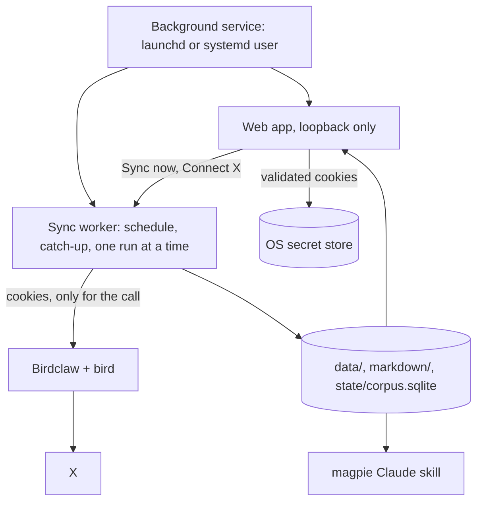
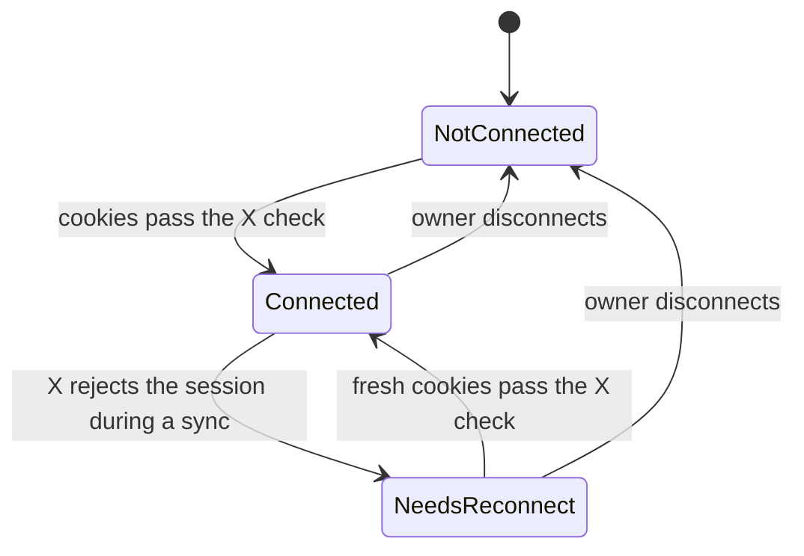
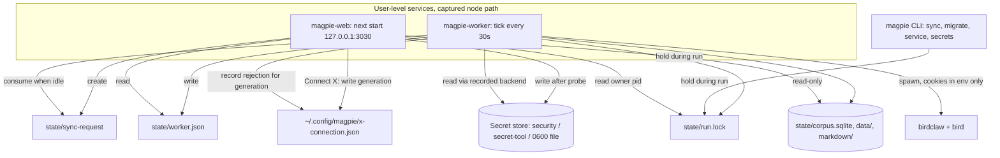
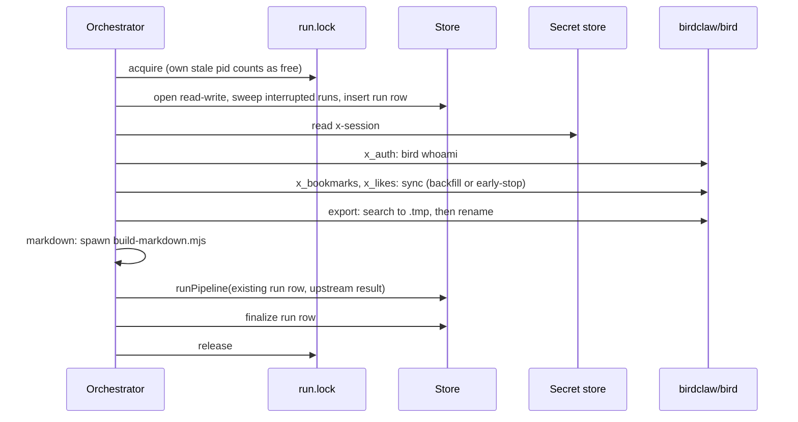
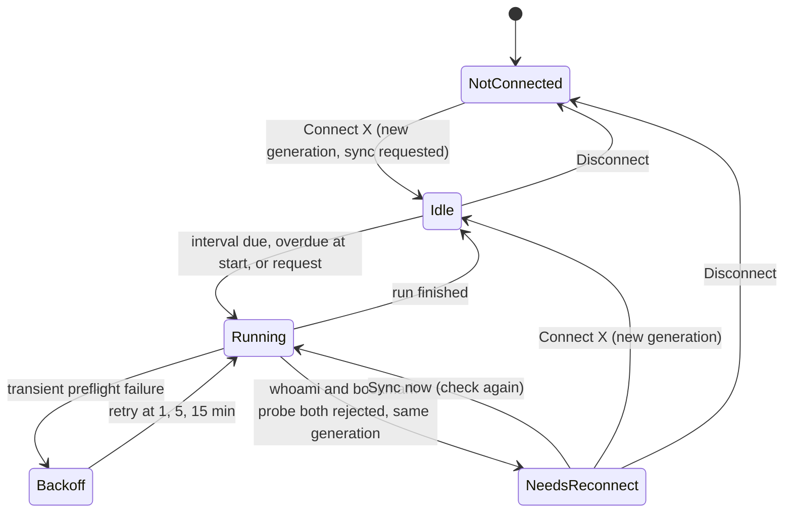
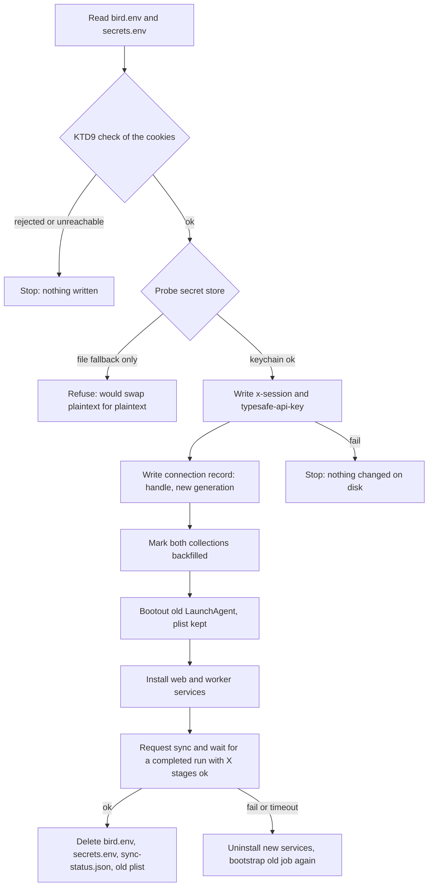

# In-App Sync Runner - Plan

## Goal Capsule

- **Objective:** Anyone who clones the open-source magpie repo can install it on their own macOS or Linux machine. After that, it keeps their X bookmarks and likes current in the background, with their X credentials stored securely and all data kept on that machine.
- **Means:** An engine-owned sync worker and the web app run as two user-level background services that magpie installs, reading secrets from the OS secret store (KTD1, KTD4, KTD8).
- **Product authority:** The owner (the repo author) is the sole decision-maker. Decisions below were made in dialogue on 2026-11-20 and govern this plan. Hosting, multi-user, and sign-in are not active scope.
- **Authority:** Product Contract requirements win on product behavior. Key Technical Decisions win on mechanism within the requirements they cite. A unit overrides neither.
- **Execution profile:** One pull request, eight units in dependency order (U1 → U8). U1 opens with a live feasibility check that gates the rest.
- **Stop conditions:** Stop and report when the U1 check shows a launchd-run process cannot read a keychain item without a prompt on macOS, when Next.js 16.4.6 or the engine fails on Node 26, or when a session-settled decision proves unworkable. Never run `migrate` against the owner's real install, install the real services, write real magpie keychain items, or delete `~/.birdclaw/bird.env` or `~/.config/magpie/secrets.env` during implementation. The owner runs the migration after merge.
- **Who finishes:** `ce-work` builds and verifies every unit. The owner runs `bun run migrate` on their Mac after merging.
- **Open blockers:** None.

---

## Product Contract

### Summary

magpie runs its own sync on a schedule. A single command installs it as a background service that runs the web app and a sync worker side by side. In the web UI, the owner connects X once by pasting their session cookies. The cookies are checked against X, stored in the OS keychain, and used only when Birdclaw runs. The sync status panel shows the next run and has a "Sync now" button. Everything stays local, single-owner, and loopback-only, and the Claude skill keeps reading local files as it does today.

### Problem Frame

The corpus stays fresh today only because of setup that exists on one Mac. A launchd job with a personal label runs a bash script that hardcodes `/Users/ianpoley/x-corpus`, finds `bird` by searching nvm folders, and loads X session cookies from a plaintext `~/.birdclaw/bird.env`. Birdclaw itself comes from Homebrew.

The repo is going open source. Someone who clones it today gets the web app and engine but no background sync. To get one, they have to hand-edit a plist, rewrite paths, install tools globally, and put their own X session cookies in a plaintext file. Even then it only works on macOS. Those cookies give full access to the X account, so storing them in plaintext is the part with real consequences.

The original question was about hosting the app on a web server. Dialogue settled that magpie stays local so the data and the Claude skill stay on the owner's machine. Making a cloned copy maintain itself is the remaining need.

### Key Decisions

- **Local only, one owner per install.** The data and the Claude skill stay on the owner's machine, and the owner has no plan to deploy. (session-settled: user-directed — chosen over local-or-own-server and server-only: server mode would cut the skill off from fresh local data.) Governs R19, R24.
- **Cookie (bird) transport, not the official X API.** It costs nothing and is what works today. The ToS and data-center IP concerns mostly go away when traffic comes from the owner's home IP. (session-settled: user-directed — chosen over the official X API via xurl with OAuth tokens: per-read cost and a separate token store.) Governs R10, R23.
- **The service runs the web app and a sync worker together.** The schedule belongs to the engine, not the web server process. Dev reloads and extra dev servers then can't restart the schedule or start a second one, and the UI still offers "Sync now" and live status. (session-settled: user-approved — chosen over the Next.js server process hosting the scheduler: hot reloads and a production-build requirement make it fragile.) Governs R1, R8, R9.
- **An OS service installer, not "sync only while the app is open".** (session-settled: user-directed — chosen over in-app-only, where the owner keeps the app running, and over a portable OS scheduler with no in-app runner.) Governs R8.
- **OS keychain for secrets, with a warned file fallback.** (session-settled: user-directed — chosen over reading cookies from the browser each run, which brings back the headless Keychain prompt, and over a locked-down plaintext file as the default.) Governs R11, R12, R15.
- **The web UI connects X, shows status, and offers Sync now.** Someone who clones the repo can set it up without editing files. (session-settled: user-directed — chosen over status-only and status plus Sync now.) Governs R10, R14, R17, R18.
- **Keep the full self-maintaining scope.** (session-settled: user-approved — chosen over a minimal portable scheduler with an install command and a setup script that writes a 0600 secrets file: that version leaves setup file-driven and cookies in plaintext.)
- **Migration proves the new setup works before removing the old one.** (session-settled: user-approved — chosen over a cut-over that deletes `bird.env` first: a partial failure would leave no working credentials.) Governs R25, R26.

### Requirements

**Sync runner**

- R1. The full sync runs inside magpie's own processes on a schedule: Birdclaw bookmarks and likes, JSON export, markdown and JSONL build, then categorize. The launchd plist and `birdclaw-nightly.sh` are retired.
- R2. The schedule defaults to every 3 hours and can be changed in a config file, not in the UI.
- R3. When magpie starts and the last scheduled run is overdue, a run starts right away.
- R4. Only one run happens at a time, whether it comes from the schedule, Sync now, or a manual CLI run. This covers the whole run, not only categorize.
- R5. Each run keeps recording the X sync result and each stage's outcome where today's sync status reads them, so current status reporting does not regress.
- R6. A CLI command still runs a sync by hand.
- R7. The first sync after X is connected on a fresh install pulls the full bookmark and like history. Later runs fetch only what is new.

**Background service**

- R8. One command installs magpie as a user-level background service on macOS and Linux that survives reboot and login. Another command removes it.
- R9. The service runs the web app and the sync worker together. A development server never starts its own scheduler.

**X credentials**

- R10. A Connect X screen accepts the owner's `auth_token` and `ct0`. It checks them against X and saves them only if they work, then shows "connected as @handle".
- R11. Stored X cookies live in the OS secret store (macOS Keychain, Linux Secret Service), scoped to magpie.
- R12. When no usable secret store exists, magpie falls back to an owner-only (`0600`) file outside the repo, and the UI and CLI show a persistent warning while it is in use.
- R13. Cookie values never reach the browser, logs, the repo, or any export. Birdclaw receives them only for the duration of a sync call.
- R14. The owner can replace the cookies or disconnect, and disconnecting deletes them from storage.
- R15. Every secret the engine reads from its secrets file (today only the Jev key, `TYPESAFE_API_KEY`) moves into the same secret store as the cookies, so the default setup keeps no plaintext secrets. Claude stays on the owner's Claude Code CLI login.
- R16. When X rejects the stored cookies, scheduled syncs pause and the UI says to reconnect X. Syncing resumes after a successful reconnect.

**Web UI**

- R17. The sync status panel shows the X connection state and the next scheduled run, along with what it shows today.
- R18. A Sync now control starts a run right away. While a run is in progress it shows that and does not start another (per R4).
- R19. The web app stays loopback-only with no sign-in, behind the existing host guard.

**Setup for people cloning the repo**

- R20. A fresh clone installs Birdclaw and `bird` as pinned repo dependencies through the repo's own install step, without Homebrew or global npm installs.
- R21. Setup checks the Node version that the pinned Birdclaw requires (Birdclaw 0.9.5 needs Node 25.8.1 or newer, below 27). On a mismatch it stops with a message that names the required range.
- R22. Runtime code, service definitions, and setup docs contain no owner-specific paths or identifiers, such as `/Users/ianpoley`, the `com.ianpoley` label, or `@ianpoley`.
- R23. The README says that Birdclaw syncs using the owner's X browser session cookies, which X's terms do not allow, and what the owner risks by doing so.
- R24. The magpie Claude skill and the local JSONL and markdown outputs keep working unchanged.

**Migrating the existing install**

- R25. The owner's current install migrates in place in this order: import the cookies from `~/.birdclaw/bird.env` and every secret in `~/.config/magpie/secrets.env` into the secret store, stop the old launchd job without removing it, install the background service, and wait for the service to finish one successful sync. Only then delete both plaintext files and remove the old launchd job. If any step fails, the new service is removed and the old job is started again, so the old setup stays intact and working.
- R26. Migration keeps the corpus data, `state/corpus.sqlite` with its edits and change log, and the Birdclaw database.

### Key Flows

- F1. First-time setup on a fresh clone
  - **Trigger:** Someone clones the repo on macOS or Linux.
  - **Steps:** Runs the install step, which checks Node and installs pinned Birdclaw and bird. Runs the service install command. Opens the web app and pastes cookies on Connect X. Sees "connected as @handle". The first sync backfills full history.
  - **Outcome:** Background syncs run every 3 hours with no files edited by hand.
  - **Covered by:** R7, R8, R10, R11, R20, R21
- F2. Scheduled sync
  - **Trigger:** The interval elapses, or magpie starts while a run is overdue.
  - **Steps:** The worker checks that no run is in progress, reads the cookies from the secret store, runs the full sync, and records each stage's outcome.
  - **Outcome:** The status panel shows the finished run and the next scheduled time.
  - **Covered by:** R1, R2, R3, R4, R5, R17
- F3. Cookies expire
  - **Trigger:** X rejects the stored session during a sync.
  - **Steps:** The run records an X auth failure. Scheduled syncs pause, and the panel shows that X needs reconnecting. The owner pastes fresh cookies, which are checked and stored, and syncing resumes.
  - **Outcome:** The system never retries a dead session on every interval, and the owner knows why syncs stopped.
  - **Covered by:** R10, R14, R16, R17
- F4. Migrating the owner's install
  - **Trigger:** The owner upgrades their existing Mac install.
  - **Steps:** Secrets are imported into the secret store. The old launchd job is stopped but left on disk. The service is installed, and its worker completes one sync. Only then are `bird.env` and `secrets.env` deleted and the old launchd job removed.
  - **Outcome:** Same corpus and edits, no plaintext secrets, and no personal launchd job.
  - **Covered by:** R25, R26

### Acceptance Examples

- AE1. **Covers R3.** Given the last run finished 5 hours ago and the machine was asleep, when magpie starts, a sync starts right away instead of waiting for the next 3-hour mark.
- AE2. **Covers R4, R18.** Given a scheduled run is in progress, when the owner clicks Sync now, no second run starts and the control shows the current run.
- AE3. **Covers R4.** Given a scheduled run is in progress, when the owner runs the CLI sync command, the command reports that a run is already in progress and exits without syncing.
- AE4. **Covers R10.** Given the owner pastes an expired `auth_token`, when they submit Connect X, nothing is stored and the screen says X rejected the cookies.
- AE5. **Covers R16.** Given X rejects the session during a scheduled run, the next intervals do not contact X until the owner reconnects. Bookmarks and likes already synced stay visible.
- AE6. **Covers R12.** Given a Linux machine with no Secret Service available, when the owner connects X, the cookies are saved to an owner-only file, and both the UI and the CLI warn that the keychain is not in use.
- AE7. **Covers R25.** Given the new runner's first sync fails during migration, `bird.env` and the old launchd job are still in place and the next scheduled launchd run succeeds as before.
- AE8. **Covers R13.** Given the owner is connected, the Connect X screen and any status response show the handle and connection state, never the cookie values.

### Success Criteria

- On a clean macOS machine and a clean Linux machine, a fresh clone goes from `git clone` to a completed first sync with no files edited by hand and no Homebrew.
- With the keychain in use, no X cookie or Jev key exists in plaintext anywhere on disk.
- The owner's Mac runs on the new setup with `bird.env`, `secrets.env`, and the `com.ianpoley.birdclaw-nightly` job gone, and no corpus edits lost.

### Scope Boundaries

**Deferred for later**

- Server mode: deploying magpie to a web server, with storage and a sign-in in front of it.
- Better Auth with X sign-in.
- A browser extension that reads X cookies in one click and refreshes them automatically.
- A data-center IP risk disclosure and opt-in for hosted syncing.
- Multiple users per install, with per-user credentials, Birdclaw roots, and corpora. The store keeps no owner column (YAGNI under local-only).
- Windows support.
- Changing the cadence from the UI.
- A Claude skill that queries a remote magpie server.
- The official X API (xurl) as a second transport.

**Outside this product's identity**

- A hosted, multi-tenant service that holds other people's X sessions.

### Dependencies / Assumptions

- Birdclaw's `bird` transport keeps working from cookies passed in as `AUTH_TOKEN` and `CT0`, as it does today in `packages/engine/bin/birdclaw-nightly.sh`.
- Birdclaw is MIT-licensed and published on npm, and honors `BIRDCLAW_HOME` for its data root (verified against installed 0.9.5).
- The owner's Claude Code CLI login works when called from a user-level background service. Today's launchd job calls the CLI the same way, but it is unverified whether categorize succeeds from launchd today (prior plan KTD4 lists `claude setup-token` as the fallback).
- Categorize stays optional: without the Jev key or the Claude CLI, sync and export still finish, as today.

### Outstanding Questions

**Resolved in planning**

- Headless secret-store access: macOS reads and writes go through `/usr/bin/security`, whose Apple signature never changes with Node upgrades (KTD1). Linux Secret Service is usually unusable on a headless or lingering box, so the R12 fallback is a first-class path there (KTD2). The macOS launchd read is still proven live at the start of U1.
- How cookies reach Birdclaw: only in the child process's environment, never in argv (KTD5).
- `@steipete/bird` 0.8.0 is MIT (LICENSE file) and pairs with Birdclaw 0.9.5 today. Both become exact-pinned dependencies (KTD6).
- Backfill and the 50-page cap: the first sync of each collection runs with `--all` and no page cap, and later runs use `--early-stop` (KTD7).
- Telling auth rejection apart from transient failure: a `bird whoami` preflight, classified as KTD9 describes.
- Node: the whole repo moves to Node 25.8.1 up to 27, with no second runtime (KTD6).

### Sources / Research

- `packages/engine/bin/birdclaw-nightly.sh`: the current sync steps, hardcoded root, `bird.env` loading, and `sync-status.json` write.
- `packages/engine/launchd/com.ianpoley.birdclaw-nightly.plist`: schedule at 00, 03, 06, 09, 12, 15, 18 and 21:00, with RunAtLoad false.
- `packages/engine/src/config.ts`: `MAGPIE_*` overrides, the secrets path, and the Claude CLI path.
- `packages/engine/src/lock.ts` and `packages/engine/bin/categorize.mjs`: the pid lock, currently held only by categorize.
- `packages/engine/src/store/schema.ts`: the `runs` and `run_stages` tables. `apps/web/src/components/sync-status.tsx` and `apps/web/src/lib/read-snapshot.ts` read them.
- `apps/web/src/proxy.ts`: the loopback host guard.
- `packages/skill/query.mjs`: the skill's default store and data paths.
- `docs/solutions/tooling-decisions/headless-claude-cli-isolation-flags.md`: constraints on calling the Claude CLI headlessly.
- `docs/plans/2026-11-19-1053-feat-corpus-screen-categories-plan.md`: KTD1 (single SQLite store) and KTD4 (Claude via the CLI login).
- Birdclaw 0.9.5 package (`package.json` engines field, `BIRDCLAW_HOME` in `dist/cli/birdclaw.js`), and https://birdclaw.sh/
- X API pay-per-use pricing, which informed the transport decision: https://docs.x.com/x-api/getting-started/pricing

---

## Planning Contract

**Product Contract preservation:** changed: R25 and F4. The order is refined so the proving sync runs under the installed background service, the risky headless path, and the old job is stopped but kept so it cannot run alongside. The intent "prove before removing, fall back intact" is unchanged. Also changed: R1 and R22 for this PR only. `packages/engine/bin/birdclaw-nightly.sh` and `packages/engine/launchd/com.ianpoley.birdclaw-nightly.plist` stay in the tree, unused by new installs, because the owner's loaded LaunchAgent runs that script from the owner's checkout and AE7's fallback needs it. A follow-up removes both after the owner migrates (see Deferred to Follow-Up Work). R10 is clarified, not changed in scope: when X answers the bookmark probe but bird's whoami can't read the handle, the screen shows "Connected" and fills in the handle at the next successful whoami (KTD9). All other R, F and AE IDs and their meaning are unchanged.

### Key Technical Decisions

- KTD1. **On macOS, all secret reads and writes go through `/usr/bin/security`, and writes are sent on stdin to `security -i`.** A keychain item's access list trusts the binary that created it. `/usr/bin/security` has a stable Apple signature, while Homebrew's `node` has only a per-build hash that changes on every upgrade and would bring back the prompt. The `-A` (allow any app) flag is never used. A native binding (`@napi-rs/keyring` 2.1.2) was rejected because the accessing binary would be `node`, and on Linux it silently falls back to an in-memory store unless that is pinned. `keytar` is archived. Governs R11.
- KTD2. **On Linux, use `secret-tool` (libsecret), with the secret on stdin. The backend is chosen once, at the first write, by a write/read/delete probe with a hard timeout.** The chosen backend (`keychain` or `file`) is recorded in a non-secret file in `~/.config/magpie/`. Every later reader and writer uses the recorded backend, and a later write that fails returns the same typed `locked` or `unavailable` result as a read, instead of probing again. Changing backends is never automatic: the owner runs `service uninstall --purge-secrets` and connects again. Disconnect and purge delete from both backends. A later read failure is reported as "secret store locked or unavailable" and never falls back to the file, so the web and worker processes cannot end up on different stores and plaintext is never written silently. The file fallback is `~/.config/magpie/secrets.env`, mode `0600`, owner-only. Until a backend is recorded (the owner's Mac before `migrate`), a read of `typesafe-api-key` falls back to `TYPESAFE_API_KEY` in the environment and then to a read-only parse of the existing `secrets.env`, exactly as today. That keeps the legacy job tagging posts until migration. Every other secret reads as not set. Governs R11, R12, R15.
- KTD3. **The X cookie pair is stored as one secret item (`x-session`, a JSON object holding `authToken` and `ct0`), and the Jev key as a second item (`typesafe-api-key`). Both are under the keychain service name `magpie`.** A single item means a reader can never see a mismatched pair partway through a reconnect. Pasted values must match a strict character allowlist (letters, digits, `%._-`) and length bounds before any I/O. This keeps them safe on `security -i`'s line-oriented stdin: the JSON value is single-quoted on the `security -i` line, which tokenizes it as one argument (checked read-only on this Mac), and the allowlist means a value can never contain a single quote. Governs R10, R13, R15.
- KTD4. **Two user-level services, `magpie-web` and `magpie-worker`, each run `node` directly as program argument 0, using the absolute node path captured at install.** On macOS these are LaunchAgents managed with `launchctl bootstrap gui/$UID`, `bootout` and `kickstart`, with `KeepAlive` set to restart on failure. On Linux they are `systemd --user` units with `Restart=on-failure` and `WantedBy=default.target`. Both units get an explicit `PATH` that starts with the captured node's directory and includes `~/.local/bin` for the Claude CLI. The web service runs `next start -H 127.0.0.1` on port 3030 (overridable with `MAGPIE_PORT`), so it never collides with `next dev` on 3000. Running node directly rather than through a bash wrapper avoids the reported LaunchAgent keychain hang. (session-settled: user-approved — chosen over the Next.js server process hosting the scheduler: hot reloads and a production-build requirement make it fragile.) Governs R8, R9.
- KTD5. **Birdclaw and bird are spawned with an explicit `env` object holding `AUTH_TOKEN`, `CT0`, `BIRDCLAW_BIRD_COMMAND`, `PATH` and `HOME`, never argv. They are never spawned unless both cookies are present.** Without both cookies, bird falls back to reading browser cookies through the Keychain (`@steipete/bird` `dist/lib/cookies.js`). That is exactly the prompt R11 exists to avoid. Nothing else in the run (categorize, the Claude CLI) inherits the cookies. Error text taken from child output is cleaned of anything matching either cookie value and capped before it is stored or logged. Governs R13.
- KTD6. **The repo pins Node `>=25.8.1 <27` (an `engines` field plus `.node-version` set to 26), and exact-pins `birdclaw@0.9.5` and `@steipete/bird@0.8.0` as engine dependencies.** Both are published on npm and both are MIT. Birdclaw declares that Node range, and one runtime is simpler than shipping a second Node for it. Setup fails with a message naming the range when the running Node is outside it (R21). `BIRDCLAW_BIRD_COMMAND` points at the pinned bird, which replaces the script's nvm search. `BIRDCLAW_HOME` keeps its default `~/.birdclaw` so the migration keeps the existing Birdclaw database (R26). Governs R20, R21.
- KTD7. **Backfill state is per collection and lives outside the store, in the scheduler state file.** The first sync of a collection runs `birdclaw sync <collection> --mode bird --all --refresh`, and later syncs keep today's `--early-stop --max-pages 50`. Migration marks both collections as already backfilled. A backfill call gets its own timeout of 6 hours, separate from the preflight and incremental timeouts. Birdclaw's bird mode keeps nothing from a failed `--all` child, so after a failed backfill the collection retries it at most once per 24 hours and runs the incremental sync on the runs in between. Governs R7.
- KTD8. **The web app and the worker talk only through files.** The worker writes `state/worker.json` (heartbeat, idle or running, next run, last attempt) atomically. Sync now creates `state/sync-request` with a timestamp. The connection record, `~/.config/magpie/x-connection.json`, is shared and non-secret: handle, `connectedAt` (the connection generation), and any auth rejection tagged with the generation it applied to. A loopback socket or HTTP control port was rejected because it adds a second listener and auth surface for no gain at a 30-second tick. Whether a run is in progress comes only from a live owner pid in `state/run.lock`, so CLI runs show too. Governs R17, R18.
- KTD9. **Auth handling.**
  - Every run starts with a `bird whoami` preflight stage (`x_auth`).
  - A failure whose text or code shows a network problem (`ENOTFOUND`, `EAI_AGAIN`, `ECONNRESET`, `ETIMEDOUT`, `fetch failed`, `HTTP 429`, `HTTP 5xx`, a child timeout) is transient: the stage fails and the KTD10 backoff applies.
  - Any other whoami failure is ambiguous. bird tries several endpoints and then scrapes `x.com/settings/account`, and its final message ("Could not parse settings page for user info", observed for fake cookies) overwrites earlier HTTP errors. So an ambiguous failure is followed by a one-page bookmark probe (`bird bookmarks` limited to one page) with the same cookies.
  - Only an auth failure of that probe too is a rejection. With fake cookies, the probe fails with "HTTP 401: Could not authenticate you" (code 32), so HTTP 401 or 403, or code 32, counts as auth. Any other probe failure is transient. Scheduled syncs then pause, and the connection record gains a rejection tagged with the current generation (R16, AE5). When the probe succeeds, the run continues and the handle is reported as unknown for that run.
  - A rejection recorded for an older generation is ignored, so a stale run can never undo a reconnect.
  - Sync now while paused re-runs the preflight, which serves as "check again".
  - Auth failures inside the bookmark or like stage fail that stage only, and the next preflight decides.
  - Connect X uses the same check. A rejection stores nothing and returns `x_rejected`. An ambiguous whoami failure with a passing probe stores the cookies and shows "Connected", and the handle fills in at the next successful whoami.

  Governs R10, R16.
- KTD10. **The scheduler is a pure decision function over persisted state (last scheduled run, consecutive failures, backoff, pending request, connection) and the current time. A 30-second tick calls it.** Timers stop while the machine sleeps, so a wall-clock comparison catches up on wake (R3). A failed or transient attempt schedules a retry 1, 5, then 15 minutes later, then returns to the normal interval, so X and the keychain are never hit every tick. The interval comes from `SYNC_INTERVAL_HOURS` in `~/.config/magpie/settings.env` (default 3), read on each tick. Governs R2, R3.
- KTD11. **One whole-run lock, `state/run.lock`, is taken by the run orchestrator and by the standalone categorize CLI.** `runPipeline` no longer takes a lock, no longer sweeps interrupted runs, and no longer reads `data/sync-status.json`. It accepts an already-open run row and an upstream result. The orchestrator owns the sweep. The lock file records the owner pid plus the boot identity (`sysctl -n kern.boottime` on macOS, `/proc/sys/kernel/random/boot_id` on Linux). A lock from a different boot, or one holding this process's own pid, is stale whether or not that pid is alive, because a pid reused after a reboot must not lock the worker out or show a phantom "Syncing now". The web's in-progress check (KTD8) applies the same rule. The standalone categorize CLI keeps reading `data/sync-status.json` for `upstream_sync` when that file exists, which the legacy script still writes, and records `unknown` only when it is absent. Governs R4, R5.
- KTD12. **The run row starts when the whole run starts.** New stage names come first, `x_auth`, `x_bookmarks`, `x_likes`, `export`, `markdown`, followed by the existing categorize stages. `upstream_sync` is derived from the two X stages. Stage names are free text in `run_stages`, so no schema migration is needed and the skill's `KNOWN_SCHEMA_VERSION` stays as it is (R24). The markdown step keeps spawning `bin/build-markdown.mjs`, not refactoring it, because its output is the skill's JSONL contract. Governs R1, R5, R24.
- KTD13. **Migration proves the new path under the real service before deleting anything.** The order is: verify the cookies from `bird.env` with the KTD9 check, import secrets, write the connection record (handle and a new generation), `bootout` the old LaunchAgent (its plist stays), install both services, request a sync, and wait (with a timeout) for a completed run whose X stages are `ok`. Only then delete the plaintext files, `data/sync-status.json` and the old plist. A rejected or unreachable check stops the migration before anything is written. Any failure uninstalls the new services, deletes the backend record and the connection record (so the legacy Jev read from KTD2 applies again), and bootstraps the old job again. The old label is read from an argument whose default is the owner's legacy label, so it lives only in the migration's legacy constant. Migrating onto the file fallback is refused with an explanation, because it would only swap one plaintext file for another. (session-settled: user-approved — chosen over deleting `bird.env` first and then cutting over: a partial failure would leave no working credentials.) Governs R25, R26.
- KTD14. **One CLI, `packages/engine/bin/magpie.mjs`, with subcommands `setup`, `service install|uninstall|status`, `secrets set-jev`, `sync`, and `migrate`. Root `package.json` scripts wrap them.** `service install` also serves as the update path: it stops the web service, runs `next build`, rewrites both unit files, and restarts both. `service uninstall` removes the units and keeps the secrets and data unless `--purge-secrets` is passed. `secrets set-jev` reads the key from stdin with echo off, so a fresh clone can add a Jev key without editing files. Governs R6, R8, R15, R20.

### High-Level Technical Design

Processes and the files they share:

One run, from the orchestrator's point of view:

Scheduler and connection states (KTD9, KTD10):

Migration (KTD13):

### Assumptions

- With no fresh worker heartbeat (older than 2 minutes), Sync now returns "Background sync isn't running", with how to start it (`bun run service:install`) or to run `bun run sync` by hand. Syncing in dev is through the CLI.
- Sync now while a run is in progress returns "already running" and is not queued (AE2). A sync that Connect X requests during a run is kept and runs after the current one.
- A sync request older than 10 minutes is dropped, so a click in dev doesn't fire days later.
- Sync now when X is not connected says to connect X first.
- While a run is in progress or a sync request is pending, the status panel polls a small loopback status route every 5 seconds, then stops. It also fetches the status once on window focus and once when the displayed next-run time passes, and starts polling if that shows a run. Nothing else polls.
- Secrets and the connection record are per user (`~/.config/magpie`, keychain service `magpie`). Data and state are per clone, so connecting X from a worktree dev server replaces the cookies the service uses. The README documents this.
- After `git pull`, the owner reruns `bun run service:install` to rebuild and restart. A Node upgrade that removes the captured node path stops the services until that rerun, and `service status` reports it.

### Risks & Dependencies

| Risk | Mitigation |
|---|---|
| A LaunchAgent can't read the keychain headless on macOS 27 (one unconfirmed report of hangs or exit 36) | U1 opens with a live check under a throwaway launchd label and item. Every `security` call has a hard timeout. A failure is a stop condition, not a silent fallback |
| bird's whoami wording changes, or 401, 403 and 429 look different than expected | An ambiguous whoami failure pauses only when a one-page bookmark probe also fails non-transiently (KTD9). Sync now re-checks |
| Next 16.4.6 or a dependency misbehaves on Node 26 | U2 runs `bun run build` and the full test suite on Node 26 before the later units depend on it. A failure is a stop condition |
| Birdclaw brings in React 19.2 and mapbox-gl next to the web app's React 19.3 | U2 checks that `apps/web` still resolves one React (build plus a `bun pm ls react` check) |
| A dev server's write action migrates the store under the service | Unchanged from today, and no migration ships in this plan (KTD12) |
| `loadSnapshot` throws while the first run is creating the store | U6 catches read-open failures and shows the empty "nothing synced yet" state |

### System-Wide Impact

- **Secret consumers:** the worker, the web Ask route (Jev key), Connect X, `secrets set-jev`, and `migrate` all go through U1's store, so the web and the worker always use the same recorded backend (KTD2).
- **Engine entry points:** `bin/categorize.mjs` changes from owning its lock and run row to sharing `run.lock` (KTD11). `bin/birdclaw-nightly.sh` stays only as the legacy fallback.
- **Run history:** existing `runs` rows keep their meaning. New rows carry five extra leading stages. `read-snapshot.ts` and `sync-status.tsx` must handle both shapes, because history rows from before this change have no X stages.
- **Skill:** it reads the same JSONL and store with no schema change (KTD12), and only its default root resolution changes (U8).
- **Owner's Mac during rollout:** the old LaunchAgent keeps running the legacy script from `~/x-corpus` after the merge, until the owner runs `migrate` (preservation note).

### Planning Sources

- `/tmp/compound-engineering-501/ce-plan-research/ee7130b9/best-practices.md` (machine-local, best effort): sources for the keychain ACL and code-signature behavior (`man security`; Apple Keychain Services access-control docs), the Linux Secret Service and linger limits, `@napi-rs/keyring` 2.1.2 and archived `keytar`, and launchd/systemd unit practice.
- `/tmp/compound-engineering-501/ce-plan-research/ee7130b9/repo-research.md` and `spec-flow.md` (machine-local, best effort): file:line evidence for the lock self-block (`packages/engine/src/lock.ts`), the categorize-only run row (`packages/engine/src/pipeline.ts`), `no_store` gating (`apps/web/src/app/actions.ts`), and bird's browser-cookie fallback.
- Observed on this machine: Birdclaw 0.9.5 `engines` is `>=25.8.1 <27`. The repo runs nvm Node 24.17.0, and Homebrew Node is 26.5.0. `bird whoami` with fake cookies exits 1 with "Could not parse settings page for user info". bird reads `AUTH_TOKEN`/`TWITTER_AUTH_TOKEN` and `CT0`/`TWITTER_CT0`. Birdclaw reads `BIRDCLAW_BIRD_COMMAND`.
- `docs/solutions/build-errors/turbopack-static-import-of-engine-workspace-package.md` (U6 loaders), `docs/solutions/tooling-decisions/headless-claude-cli-isolation-flags.md` (the Claude CLI flags stay unchanged under the services), `docs/solutions/workflow-issues/one-next-dev-server-per-app-directory.md` (port 3030 for the service).

### Scope Additions and Non-Goals From Planning

#### Deferred to Follow-Up Work

- Remove `packages/engine/bin/birdclaw-nightly.sh`, `packages/engine/launchd/com.ianpoley.birdclaw-nightly.plist`, and the legacy-label default in the migration once the owner has migrated. Until then they are the AE7 fallback.
- Add the `@typescript-eslint/no-restricted-imports` rule for `@magpie/engine` that `docs/solutions/build-errors/turbopack-static-import-of-engine-workspace-package.md` recommends.

#### Considered and not built

- A warning when Connect X uses a different X account than before. The product has one owner and one account, so this would only matter after a mistake. It would be worth adding if multiple accounts ever enter scope.
- A CLI cookie-paste command. The UI covers R10, and a headless Linux owner can reach the loopback UI over an SSH tunnel. It would be worth adding if users report having no way to open the UI.
- An automatic or one-command move between secret backends. A move today is `service uninstall --purge-secrets` and connecting again, which is rare enough for a single owner. It would be worth adding if Linux owners often change between headless and desktop use.
- Removing Birdclaw demo posts already ingested into an existing `state/corpus.sqlite` (the owner's has `tweet_001` and `tweet_006`). U2 stops new ones, and the owner can hide the two from the screen. It would be worth adding if other installs report seeded posts.
- A streamed progress feed. Polling every 5 seconds during a run is enough for runs that take minutes.
- Atomic markdown output. `build-markdown.mjs` writes files in place today, and the skill tolerates that. It would be worth changing if the skill is ever seen reading a half-written file.

---

## Implementation Units

### U1. Secret store

- **Goal:** One engine module stores, reads and deletes the magpie secrets on macOS, on Linux, and in the file fallback, without a prompt under a background service.
- **Requirements:** R11, R12, R13, R14, R15; KTD1, KTD2, KTD3.
- **Dependencies:** None.
- **Files:**
  - `packages/engine/src/secrets/store.ts` (new: backend selection, probe, recorded backend, get/set/delete)
  - `packages/engine/src/secrets/backends.ts` (new: `security` and `secret-tool` invocations, file backend)
  - `packages/engine/src/secrets.ts` (keep `parseSecrets` for the file backend and migration)
  - `packages/engine/src/jev/client.ts` (the key read becomes async through the store)
  - `packages/engine/bin/categorize.mjs`
  - `apps/web/src/app/api/ask/route.ts` (await the async client)
  - `packages/engine/src/config.ts` (config dir, settings, backend-record and connection-record paths, with `MAGPIE_CONFIG_DIR` override, plus `MAGPIE_KEYCHAIN_SERVICE` (default `magpie`) and a test-only `MAGPIE_SECRET_BACKEND=file` that forces the file backend)
  - `packages/engine/test/secret-store.test.ts` (new)
- **Approach:**
  1. Live check first. Write an `x-session`-shaped JSON value such as `{"authToken":"abc%2E_-","ct0":"def"}` through the new backend's own `set`, under a throwaway service name. Then have a throwaway LaunchAgent with a test label run `node` directly and read it back through `get`, requiring an exact match. Run the read once right after load and once after a `kickstart`. Record the result in the PR, then remove the item and the agent. If it prompts, hangs or mismatches, stop (Goal Capsule).
  2. Backends call the OS tools with secrets on stdin only, and every call has a hard timeout (KTD1, KTD2).
  3. The first `set` probes and records the backend. Later `set` and `get` calls use the recorded backend only, and a failure returns a typed `locked` or `unavailable` result. With no backend recorded, `get('typesafe-api-key')` uses the legacy read from KTD2.
  4. Validate cookie shape before any I/O (KTD3).
  5. The file backend writes with mode `0600` through a `.tmp` file and rename, and refuses to read a file that group or others can read.
- **Execution note:** Start with the live launchd check. Everything after it depends on its result.
- **Patterns to follow:** `packages/engine/src/claude/cli.ts` (`spawn`, a settle-once guard, a timeout with SIGKILL, typed failures, an injected adapter). `packages/engine/test/claude-cli.test.ts` (shell-script stubs that record argv and stdin).
- **Test scenarios:**
  - A stub `security` gets a set and then a get of `x-session`. The secret appears only on stdin, never in argv, and get returns the same pair.
  - A probe that fails on Linux (a `secret-tool` stub exits nonzero) makes set record `file`. The file is created with mode `0600`, and the record says `file`.
  - With a recorded backend of `keychain`, a `security` stub that times out makes get return `locked` within the timeout and leaves the fallback file untouched.
  - A fallback file with mode `0644` is refused with a clear message.
  - `auth_token` values containing a newline, a quote, a space, or longer than 512 characters are rejected before any child process starts.
  - Delete removes the item, and a later get returns "not set".
  - `createJevClient` resolves the key from the store, and when it is absent it fails with the existing "no key" error.
  - With no backend recorded and a `0600` `secrets.env` holding `TYPESAFE_API_KEY`, `createJevClient` resolves the key and the file is not modified.
  - With `keychain` recorded, a `set` whose `security` call fails returns `unavailable`. The record still says `keychain` and no fallback file is created.
  - Delete through disconnect removes the item from both the keychain stub and the fallback file.
- **Verification:** The live check is recorded as passing on this Mac. A stubbed test suite covers both backends and the fallback.

### U2. Runtime pins and the Birdclaw adapter

- **Goal:** The repo runs on one pinned Node, and an injected adapter runs bird whoami, Birdclaw sync, and export safely.
- **Requirements:** R13, R16, R20, R21; KTD5, KTD6, KTD7, KTD9.
- **Dependencies:** U1 (it reads `x-session`).
- **Files:**
  - `package.json` (`engines`)
  - `.node-version` (new)
  - `packages/engine/package.json` (exact `birdclaw` and `@steipete/bird` dependencies)
  - `bun.lock`
  - `packages/engine/src/x/birdclaw.ts` (new: `whoami`, `sync(collection, mode)`, `export(collection, outFile)`, failure classification)
  - `packages/engine/src/config.ts` (paths for markdown, logs and Birdclaw home, plus `MAGPIE_BIRD_BIN` and `MAGPIE_BIRDCLAW_BIN` overrides that replace the resolved pinned bins, used by every verification run)
  - `packages/engine/test/birdclaw.test.ts` (new)
- **Approach:**
  1. Resolve both packages' bin entry files from the engine package. Run them with the captured `process.execPath` and set `BIRDCLAW_BIRD_COMMAND` to the pinned bird.
  2. Build the child env explicitly (KTD5), and return `missing_cookies` without spawning when either cookie is absent.
  3. Export streams stdout to a `.tmp` file and renames it on success, keeping the previous file on failure. Before the rename, drop records whose `id` is not a numeric X status id. Birdclaw 0.9.5 seeds demo posts such as `tweet_006` into an empty database, and the owner's current `data/bookmarks.json` already holds `tweet_001` and `tweet_006`.
  4. Classify failures per KTD9, including the one-page bookmark probe that follows an ambiguous whoami failure, and clean child text per KTD5.
  5. Run `bun run build` and the whole test suite on Node 26 here, before later units build on it.
- **Patterns to follow:** `packages/engine/src/claude/cli.ts`, and the export steps of `packages/engine/bin/birdclaw-nightly.sh`.
- **Test scenarios:**
  - A stub `bird` that prints a handle makes whoami return that handle. The stub records that `AUTH_TOKEN` and `CT0` were in its env and absent from argv.
  - With only `authToken` present, the adapter returns `missing_cookies` and the stub never runs.
  - A whoami stub that exits 1 with "Could not parse settings page for user info", while the bookmark probe stub fails with "HTTP 401: {\"errors\":[{\"message\":\"Could not authenticate you\",\"code\":32}]}", is classified as rejected.
  - The same whoami failure with a probe that fails with "HTTP 503" is classified as transient.
  - The same whoami failure with a bookmark probe that succeeds is classified as ok with an unknown handle.
  - A whoami stub whose output contains "HTTP 429" is classified as transient without running the probe.
  - A stub that exits 1 with "getaddrinfo ENOTFOUND x.com", and one that exceeds the timeout, are classified as transient.
  - Stub output that contains the cookie value is stored with that value cleaned out.
  - A failing export leaves the previous `bookmarks.json` untouched and removes the `.tmp` file.
  - A backfill call uses the 6-hour backfill timeout, and an incremental call uses the shorter one.
  - A collection with no backfill record runs with `--all` and no `--max-pages`. A backfilled one runs with `--early-stop --max-pages 50`.
  - An export whose JSON contains `tweet_006` writes `bookmarks.json` without it, and keeps numeric ids unchanged.
- **Verification:** The tests pass, and `bun run build` plus `bun run test` pass on Node 26 with one React in `apps/web`.

### U3. Whole-run orchestrator, lock and run recording

- **Goal:** One run function does the whole sync, X through categorize, under a single lock, and records every stage in one run row.
- **Requirements:** R1, R4, R5, R6, R7; F2; AE3; KTD11, KTD12.
- **Dependencies:** U2.
- **Files:**
  - `packages/engine/src/sync/run.ts` (new)
  - `packages/engine/src/pipeline.ts` (takes an existing run row and upstream result, with no lock, no sweep and no `sync-status.json` read)
  - `packages/engine/src/lock.ts` (records pid plus boot identity. A lock from another boot or holding our own pid is stale)
  - `packages/engine/bin/categorize.mjs` (takes `run.lock` and creates its own run row)
  - `packages/engine/bin/sync.mjs` (new, a thin wrapper kept for `bun run sync`)
  - `packages/engine/src/config.ts` (`run.lock` path)
  - `packages/engine/test/sync-run.test.ts` (new)
  - `packages/engine/test/pipeline.test.ts` (updated)
- **Approach:**
  1. Acquire the lock, open the store read-write, sweep, and insert the run row.
  2. Read secrets. When X is not connected, record `x_auth` as skipped and finish the run without X stages.
  3. Run the X stages, export and markdown, each through the existing stage recorder. Then call `runPipeline` with the open row.
  4. Update backfill state after a collection's backfill succeeds (KTD7).
  5. Return a typed result the worker reads: completed, with whether the X stages were ok, plus any auth classification.
- **Execution note:** Add characterization coverage that the existing categorize stage order and messages survive the refactor before you change `runPipeline`.
- **Patterns to follow:** `stage()` and the run finalization in `packages/engine/src/pipeline.ts`, and the `fakes()` and `setup()` helpers in `packages/engine/test/pipeline.test.ts`.
- **Test scenarios:**
  - With a fake adapter that succeeds, one run row holds stages `x_auth`, `x_bookmarks`, `x_likes`, `export`, `markdown`, then the categorize stages in their old order, with `upstream_sync` set to `ok`.
  - A fake `x_likes` failure leaves `upstream_sync` as `failed`, and categorize still runs on the cached export.
  - Covers AE3. With `run.lock` held by a live other pid, the CLI sync reports that a run is in progress and exits 1 without opening the store.
  - A `run.lock` holding this process's own pid is taken over.
  - A `run.lock` holding a live foreign pid with a different boot identity is taken over.
  - A leftover `running` row from a killed run is marked interrupted at the next run start, and the new row stays `running` until it is finalized.
  - A collection whose backfill failed 3 hours ago runs the incremental sync, and one whose backfill failed 25 hours ago retries the backfill.
  - With no `x-session`, the run records `x_auth` as skipped and `upstream_sync` as `unknown`, and does not spawn the adapter.
  - The standalone categorize CLI with a `data/sync-status.json` that shows a failed likes sync records `upstream_sync` as `failed`.
  - The standalone categorize CLI with no `data/sync-status.json` records `upstream_sync` as `unknown`.
- **Verification:** `bun run sync` against a temp root with fake adapters produces the full stage list, and the existing pipeline tests still pass.

### U4. Worker and scheduler

- **Goal:** A long-running worker process starts runs on schedule, catches up after sleep, honors Sync now, backs off on failure, and pauses only on a real auth rejection.
- **Requirements:** R2, R3, R4, R16, R18; F2, F3; AE1, AE2, AE5; KTD8, KTD9, KTD10.
- **Dependencies:** U3.
- **Files:**
  - `packages/engine/src/sync/scheduler.ts` (new, the pure decision function)
  - `packages/engine/src/sync/worker.ts` (new: tick loop, state file I/O, heartbeat, request consumption)
  - `packages/engine/src/sync/state.ts` (new: atomic JSON read and write for `worker.json`, scheduler state, `sync-request` and the connection record)
  - `packages/engine/bin/worker.mjs` (new)
  - `packages/engine/test/scheduler.test.ts` (new)
  - `packages/engine/test/worker.test.ts` (new)
- **Approach:**
  1. Each tick, including ticks while a run is in progress (the run is awaited off the tick loop, so a 6-hour backfill never looks like a dead worker): write the heartbeat, read state, call the scheduler, and either do nothing or run the orchestrator. Consume a request only when idle, and drop requests older than 10 minutes.
  2. After a run, update the last scheduled run, failures and backoff, and record a rejection only for the current generation (KTD9).
  3. Persist all state with a `.tmp` file and rename. A corrupt or missing state file means a fresh state, never a crash.
  4. Handle SIGTERM by finishing the current stage boundary and releasing the lock.
- **Execution note:** Implement the scheduler test-first. It is a pure function, and most of the edge cases live there.
- **Test scenarios:**
  - Covers AE1. The last run was 5 hours ago, the interval is 3 hours, and this is the first tick after start: the decision is run now.
  - The last run was 1 hour ago with no request: the decision is wait, and the next run is in 2 hours.
  - A transient failure, then ticks at 30 seconds and at 61 seconds: the first waits and the second retries. Later retries are spaced at 5 and then 15 minutes.
  - Covers AE5. A run result classified as rejected for generation G: the decision is paused, and further due ticks do not run.
  - A run result with a transient preflight failure: the decision is backoff, not paused.
  - A rejection recorded for generation G while the connection record now has generation G+1: the decision is not paused.
  - A paused state with a fresh Sync now request: run (check again).
  - Covers AE2. A request arrives while `run.lock` has a live owner: the worker leaves the request in place and starts no second run.
  - A request 11 minutes old is dropped without running.
  - `SYNC_INTERVAL_HOURS=6` in settings changes the next run without a restart.
  - Worker integration: with a fake orchestrator, one tick writes `worker.json` with a heartbeat and the next run time, and a request file is consumed exactly once.
- **Verification:** The scheduler and worker tests pass, and `node bin/worker.mjs` against a temp root with fake adapters runs one requested sync and then idles.

### U5. Service installer and CLI

- **Goal:** One command installs, updates, inspects or removes the two background services on macOS and Linux, and setup checks the environment.
- **Requirements:** R6, R8, R9, R15, R20, R21; F1; KTD4, KTD6, KTD14.
- **Dependencies:** U4.
- **Files:**
  - `packages/engine/src/service/launchd.ts` (new: render the plist and run the `launchctl` commands)
  - `packages/engine/src/service/systemd.ts` (new: render the units and run the `systemctl --user` commands)
  - `packages/engine/src/service/index.ts` (new: platform selection, install/uninstall/status, build step)
  - `packages/engine/bin/magpie.mjs` (new)
  - `package.json` (scripts `setup`, `service:install`, `service:uninstall`, `service:status`, `secrets:set-jev`, `migrate`)
  - `packages/engine/test/service.test.ts` (new)
- **Approach:**
  1. Renderers are pure functions over the captured node path, repo root, port and log directory.
  2. Command runners are injected, so tests never touch real launchd or systemd.
  3. Install runs `setup` checks, stops the web service, runs `next build`, writes the units, and starts or kickstarts both.
  4. `setup` checks the environment: Node range, pinned Birdclaw and bird resolvable, the Claude CLI found (optional), and secret store usability. Secret store usability is probed under a throwaway service name and records no backend. `service status` reports units loaded, worker heartbeat age, the recorded secret backend, and whether the captured node path still exists and is in range.
  5. Labels and unit names are `magpie-web` and `magpie-worker`, with no owner identifiers (R22).
- **Execution note:** This is mostly packaging. Prefer rendered-output tests plus one `setup` run on this machine over a real install, which the Goal Capsule forbids.
- **Test scenarios:**
  - On darwin, two plists are rendered, each with program argument 0 equal to the captured node path, an explicit `PATH` starting with its directory and containing `~/.local/bin`, `KeepAlive` on failure, and log paths under `logs/`. Neither plist contains a secret or "ianpoley".
  - On linux, two units are rendered with `Type=exec`, `Restart=on-failure`, a nonzero `RestartSec`, `WantedBy=default.target`, and the same node path and `PATH`.
  - The web unit runs `next start -H 127.0.0.1 -p 3030`, and `MAGPIE_PORT=4000` changes it.
  - Install with fake runners calls stop, build, write, bootstrap and kickstart in that order. A failed build leaves the old units in place.
  - Uninstall removes both units and keeps secrets, and `--purge-secrets` also deletes them.
  - `setup` on Node 24.17 exits nonzero with a message naming `>=25.8.1 <27`.
  - `secrets set-jev` reads the key from stdin and stores it through U1. The value never appears in output.
- **Verification:** The tests pass, and `bun run setup` on this Mac reports each check accurately.

### U6. Web: status, Sync now, Connect X

- **Goal:** The owner sees connection state, the next run and live progress, can start a sync, and can connect, replace or disconnect X from the UI.
- **Requirements:** R10, R12, R13, R14, R16, R17, R18, R19; F1, F3; AE2, AE4, AE6, AE8; KTD3, KTD8, KTD9.
- **Dependencies:** U1, U4.
- **Files:**
  - `apps/web/src/lib/engine.ts` (loaders for the secret store, sync state and X adapter)
  - `apps/web/src/app/actions.ts` (`connectX`, `disconnectX`, `requestSync`. These do not use `withStore`, because none of them needs the store)
  - `apps/web/src/app/api/sync-status/route.ts` (new: same-origin JSON status for polling)
  - `apps/web/src/lib/types.ts` (new `ActionErrorCode` members `x_rejected`, `x_unreachable`, `not_connected`, `run_in_progress`, `no_worker`, `secret_store_locked`, and a `SyncState` type)
  - `apps/web/src/lib/snapshot.ts` and `apps/web/src/lib/read-snapshot.ts` (sync state without the store, and a store open failure treated as empty)
  - `apps/web/src/components/sync-status.tsx` (running checked first; next run, connection and fallback warning; Sync now)
  - `apps/web/src/components/connect-x-dialog.tsx` (new)
  - `apps/web/src/components/sidebar.tsx`
  - `apps/web/test/sync-actions.test.ts` (new)
  - `apps/web/test/sync-status.test.ts` (new)
- **Approach:**
  1. `connectX` validates the input shape, runs the KTD9 check through the adapter, and stores the pair. It then writes a new connection generation with the handle (or unknown) and requests a sync. Errors never log the input or the error object, only its name (R13).
  2. `requestSync` checks connection, heartbeat and lock-owner liveness per the Assumptions before creating the request.
  3. `describe()` becomes an exported pure function, and running is checked before failed stages.
  4. The panel polls the status route per the Assumptions.
  5. Panel states, highest priority first, each with one primary action:
     - **Needs reconnect**: "X needs reconnecting", action Reconnect X. This message is exempt from the two-line clamp.
     - **Secret store locked**: "Can't read the keychain", with a hint to unlock it. Action Sync now.
     - **Not connected**: "Connect X to start syncing", action Connect X.
     - **Running** (worker or CLI): "Syncing now", plus the current stage. The action shows as disabled.
     - **Request pending**: "Sync requested". The action shows as disabled.
     - **No worker**: "Background sync isn't running", with the `bun run service:install` hint. Action Sync now, which returns the hint.
     - **Idle**: last sync and next run. Action Sync now.
     - **Empty store**: "Nothing synced yet" plus whichever of the above applies.
     - The fallback-file warning is a separate persistent line under any state.
     - A Sync now refusal shows inline under the button with its cause and next step.
     - Connect X opens from the panel. Replace and Disconnect live inside the same dialog.
  6. The dialog has two password-style fields labeled `auth_token` and `ct0`, and one help line on copying them from the browser's dev tools (Application, then Cookies, then x.com). The same help appears in the README.
     - While submitting, the form is disabled and shows "Checking with X".
     - Each error code has inline copy: `x_rejected` says X didn't accept these cookies, `x_unreachable` says X couldn't be reached so try again, `invalid_input` names the field, and `secret_store_locked` says to unlock the keychain.
     - On success it shows "Connected as @handle", or "Connected", then closes.
  7. Accessibility: the panel stays a polite live region that announces run completion once. Sync now uses `aria-disabled` rather than `disabled`, so focus is not lost when it changes state. Dialog errors are tied to their field with an alert role, and focus returns to the Connect X trigger when the dialog closes.
  8. The Connect X dialog (step 6) uses UI SDK Dialog and Input (password-style; check its docs per `apps/web/AGENTS.md`). Disconnect uses AlertDialog. Read the bundled Next docs before adding the route (`apps/web/AGENTS.md`).
- **Patterns to follow:** Validators and `ActionResult` in `apps/web/src/app/actions.ts`, `isSameOriginJson` in `apps/web/src/app/api/ask/route.ts`, `category-menu.tsx` (dialog form), `merge-dialog.tsx` (AlertDialog), and `apps/web/src/components/styles.ts`. Use the existing status and side tokens from `apps/web/DESIGN.md`, with a new OKLCH token only if the connected state needs one.
- **Test scenarios:**
  - `connectX` with a fake adapter that returns `@owner` stores the pair through a fake store, writes a connection record with a new `connectedAt`, creates a sync request, and returns the handle and no cookie values.
  - Covers AE4. `connectX` with an adapter classification of "counts toward rejection" returns `x_rejected` and stores nothing.
  - `connectX` with a transient classification returns `x_unreachable` and stores nothing.
  - `connectX` with `ct0` containing a newline returns `invalid_input` before the adapter is called.
  - Covers AE6. With the recorded backend `file`, the status includes the fallback warning.
  - Covers AE8. The status route's JSON and the snapshot never contain the cookie values, checked by searching the serialized output for both.
  - Covers AE2. `requestSync` with a live lock owner returns `run_in_progress` and creates no request file.
  - `requestSync` with a heartbeat older than 2 minutes returns `no_worker`, and with no connection returns `not_connected`.
  - `disconnectX` deletes the secret and clears the connection record, and a following `requestSync` returns `not_connected`.
  - `describe()` with a running run that already has a failed `x_likes` stage reports "Syncing now".
  - `describe()` returns each panel state from step 5 for its inputs. Needs reconnect plus the fallback warning returns needs reconnect with the warning line. A pending request returns "Sync requested" with the action disabled.
  - `connectX` with an ambiguous whoami failure and a passing bookmark probe stores the pair and returns "Connected" with no handle.
  - A snapshot read while the store file exists but its open fails returns the empty state instead of throwing.
- **Verification:** The web tests pass and `bun run build` passes. A browser check against `next start` shows Connect X, a rejection message, the next run, Sync now (requested, then running), and the fallback warning. It runs with a temp root and config dir, `MAGPIE_KEYCHAIN_SERVICE` set to a throwaway name or `MAGPIE_SECRET_BACKEND=file`, and stub bird and birdclaw bins.

### U7. Migration of the existing install

- **Goal:** The owner's Mac moves to the new setup in one command, and any failure leaves the old job running.
- **Requirements:** R25, R26; F4; AE7; KTD13.
- **Dependencies:** U1, U5.
- **Files:**
  - `packages/engine/src/migrate/legacy.ts` (new)
  - `packages/engine/bin/magpie.mjs` (`migrate` subcommand)
  - `packages/engine/test/migrate.test.ts` (new)
- **Approach:**
  1. Follow the KTD13 order with injected filesystem, adapter, secret-store, service and launchctl runners. The KTD9 check of the `bird.env` cookies runs before any write. The connection record is written after the secrets and before the services are installed.
  2. The wait reads `state/worker.json` and the latest run row until a completed run with `x_bookmarks` and `x_likes` both `ok`, or a timeout (default 15 minutes).
  3. Print each step, never print secret values, and say exactly what state the machine was left in on failure.
- **Execution note:** Verify only with a fake HOME and fake runners. The Goal Capsule forbids running this on the real install.
- **Test scenarios:**
  - Happy path with fakes: the cookies are checked, secrets are written, the connection record is written with the returned handle, the old job is booted out, services are installed, and the run completes with ok X stages. Then both plaintext files, `data/sync-status.json` and the old plist are deleted, in that order.
  - The cookie check returns rejected: the keychain, the connection record, the old job and both files are untouched.
  - Covers AE7. The proving run finishes with `x_likes` failed: the new services are uninstalled, the old job is bootstrapped again, and `bird.env`, `secrets.env` and the plist still exist.
  - The wait times out: same rollback as above, and the backend and connection records are deleted, so a following legacy categorize still reads the Jev key from `secrets.env`.
  - The secret store probe yields only the file fallback: migration refuses before changing anything.
  - Writing the secret fails: nothing is booted out, and both files are untouched.
  - The scheduler state after a successful migration marks both collections backfilled, so the first worker run uses `--early-stop`.
  - `bird.env` with `export AUTH_TOKEN="…"` quoting is parsed by `parseSecrets`.
- **Verification:** The migration tests pass with fakes for every branch.

### U8. Owner-neutral docs, skill root, and the ToS note

- **Goal:** A fresh clone anywhere on disk can follow the README to a working background sync, and the skill finds that clone's data.
- **Requirements:** R22, R23, R24; Success Criteria.
- **Dependencies:** U5, U6, U7.
- **Files:**
  - `README.md`
  - `packages/engine/README.md`
  - `packages/engine/SETUP.md` (rewritten for setup, connect, service install, migration)
  - `apps/web/README.md`
  - `packages/skill/query.mjs` (the default root comes from the skill's own real path, so it follows the clone)
  - `packages/skill/SKILL.md`
  - `packages/skill/test/query.test.mjs`
  - `packages/engine/package.json` (`description`, `sync` script)
- **Approach:**
  1. Remove the owner-specific strings and the `~/x-corpus` assumptions listed in the repo research. The legacy script, plist and the migration's legacy constant are left alone (preservation note).
  2. Add the cookie and ToS paragraph (R23), the per-user secrets note (Assumptions), the update path (`service:install` after pull), and the port. Also add that the service listens on loopback with no sign-in, so it assumes a machine where only the owner has a login: any other local account could open the app, read the corpus, and connect or disconnect X.
  3. The skill resolves its root from `realpath` of its own file, so the `~/.claude/skills` symlink points back to the clone. `MAGPIE_DIR` and `MAGPIE_STORE` keep overriding it.
- **Test scenarios:**
  - A skill test runs `query.mjs` through a symlink in a temp dir that points at a temp clone and reads that clone's store with no env overrides.
  - A search for `ianpoley` and `/Users/` across runtime code (`packages/*/src`, `packages/*/bin`, `apps/web/src` except `proto/`), service renderers and setup docs (`README.md`, `packages/*/README.md`, `packages/engine/SETUP.md`, `packages/skill/SKILL.md`) finds nothing beyond the legacy script, the legacy plist and the migration's legacy constant (Verification Contract).
- **Verification:** The skill tests pass, the search is clean, and the README steps match the CLI's actual subcommands.

---

## Verification Contract

| Gate | Command or check | Applies to |
|---|---|---|
| Unit and integration tests | `bun run test` (node --test across engine, skill, web) | Every unit |
| Types | `bun run typecheck` | Every unit |
| Lint | `bun run lint` | U6 |
| Production build | `bun run build` on Node 26 | U2, U6 |
| Live keychain check | Throwaway LaunchAgent reads a throwaway `security` item with no prompt, then both are removed | U1 |
| Setup | `bun run setup` reports Node range, pinned tools, Claude CLI and secret store accurately | U5 |
| Browser check | `next start` on a spare port, with a temp `MAGPIE_ROOT` and `MAGPIE_CONFIG_DIR`, a throwaway `MAGPIE_KEYCHAIN_SERVICE` or `MAGPIE_SECRET_BACKEND=file`, and stub `MAGPIE_BIRD_BIN` and `MAGPIE_BIRDCLAW_BIN`. Check Connect X, rejection, next run, Sync now, and the fallback warning | U6 |
| Owner-string search | `git grep -n -e ianpoley -e '/Users/'` limited to runtime code, service renderers and setup docs as U8 lists, excluding the legacy script and plist and the migration's legacy constant: no hits. Plans, solutions docs and tests that assert on these strings are out of scope | U8 |

All verification uses temp roots, temp config dirs and throwaway keychain items. Nothing touches the owner's real secrets, real LaunchAgents or real store.

## Definition of Done

- Every unit's test scenarios exist and pass, and every gate in the Verification Contract passes.
- No cookie value, Jev key or `ianpoley` path appears in any new runtime file, log line, test snapshot or rendered unit.
- The live keychain check result is recorded in the PR description.
- The README tells a fresh clone how to run setup, connect X, install the service, update after a pull, and migrate from the legacy job.
- Abandoned-attempt code, throwaway keychain items, and throwaway LaunchAgents from verification are removed.
