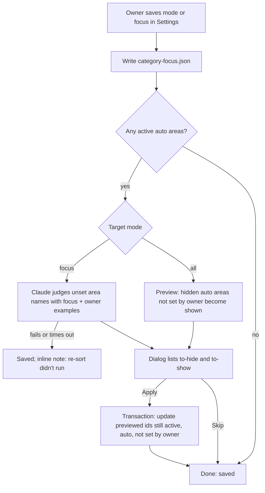

# Category Focus and Settings - Plan

## Goal Capsule

- **Objective:** A person whose saved posts aren't mostly about software sees their own categories, not a sidebar where most areas start out hidden. They can change that choice later from one Settings page, which also holds their X connection, Jev key, and the status of background sync and the Claude skill link.
- **Means:** A per-install category focus setting that Claude reads whenever it creates areas. The setting is picked in a third setup step and edited on a new `/settings` route (KTD1, KTD2, KTD7).
- **Product authority:** The Product Contract below. The R wins on product behavior, and the KTD wins on mechanism within its cited Rs.
- **Stop conditions:** Stop and ask if implementation shows that the setup gate can run with no reachable config directory, that the hand-set backfill (KTD3) would misclassify system areas, or that a web server action cannot spawn the Claude CLI under the user's login.
- **Execution profile:** One PR. Standard depth. Units are dependency-ordered.
- **Who finishes:** `ce-work` builds and verifies locally, and the user reviews and merges.
- **Open blockers:** None.

---

## Product Contract

Product Contract preservation: changed: added R17 and AE7. Owner-set areas now feed the focus judgment as examples, approved by the user during planning. The rationale on the "Only the web setup asks" Key Decision was corrected, because a first sync can start before step 3. R1–R16 and AE1–AE6 are unchanged.

### Summary

Setup gets a third step where the person picks **Show everything** (the default) or **Only show my focus**, which comes with a free-text focus box. When Claude creates areas, it judges them against that focus instead of the fixed "dev" test, and it learns from areas the person has already shown or hidden by hand. A new Settings page holds the same control, plus the X connection, the Jev key, and read-only status for background sync and the Claude skill link.

### Problem Frame

Right now, when Claude creates an area, at first discovery or when evolve adds one, it tags the area "dev" or "not dev". Every non-dev area starts hidden. Someone who saves posts about climbing, cooking, or politics finds most of their corpus behind "Show hidden", and their only fix is unhiding areas one at a time. The skill's instructions to Claude repeat the same assumption by calling hidden areas "non-dev ones such as politics". There is also no Settings page in the app. The X cookies and Jev key can only be entered in setup or the reconnect dialog, and background sync and the skill link are visible only from the CLI.

### Key Decisions

- **The choice is a two-way mode, show everything or only my focus. It is not a pick-list of areas.** Categories don't exist until the first sync finishes discovery, so setup has no areas to list. Governs R1, R2, R3. (session-settled: user-directed — chosen over a focus text box alone, dropping auto-hide entirely, or preset interest chips: an explicit mode with show-all as the default makes no assumption about the person.)
- **Changing the focus setting asks each time whether to re-sort existing categories.** Re-sorting always would surprise people, and applying the change only to new areas would make the change look like it did nothing. Governs R9, R10, R11. (session-settled: user-directed — chosen over always re-sorting existing areas and over applying only to future areas.)
- **Settings v1 holds the focus setting, X connection, Jev key, background sync status, and Claude skill link status.** Governs R12–R15. (session-settled: user-directed — the user chose all four candidate sections.)
- **Owner-set areas teach the focus judgment.** A rough focus written before any categories exist gets better with each manual correction, and nothing new has to be stored. Governs R17. (session-settled: user-approved — proposed with its prompt-size and untrusted-name tradeoffs shown; the user chose to fold it in over keeping the focus text as the only input.)
- **Existing installs move to "Only show my focus", prefilled with today's dev wording.** This way nothing in an upgraded sidebar changes. Governs R5.
- **Only the web setup asks.** The CLI walkthrough doesn't, because connecting X happens only in the web app, and discovery waits until the setting is chosen. Governs R1, R4.

### Requirements

**Choosing what to show**

- R1. The web setup gate adds a third step after Connect X and Add your Jev key. In that step the person picks **Show everything** or **Only show my focus**.
- R2. **Show everything** is selected by default. Picking **Only show my focus** reveals a free-text box describing what they save posts for, for example "climbing and trail running".
- R3. Setup cannot finish with **Only show my focus** selected and an empty focus box.
- R4. The choice is saved per install and applies from the first discovery onward.
- R5. An install that existed before this change behaves as if it chose **Only show my focus** with a focus equal to today's dev definition: software development, engineering, design, building products. Its current hidden states are left unchanged.

**How areas are judged**

- R6. In **Show everything** mode, no area or topic is ever hidden automatically. Discovery and evolve both create every area visible.
- R7. In **Only show my focus** mode, Claude judges each new area against the person's focus text, at discovery and when evolve creates an area. Areas outside the focus start hidden, and areas inside it start visible.
- R8. Hiding or unhiding an area or topic by hand works the same in both modes, and nothing automatic ever overrides a hand-set state.
- R17. In **Only show my focus** mode, every focus judgment also receives the names of the areas the person has shown by hand and the areas they have hidden by hand, as examples of their focus.

**Changing the setting later**

- R9. When the person saves a change to the mode or the focus text in Settings, Magpie offers to re-sort existing categories. Before applying anything, it lists which areas would become hidden and which would become shown.
- R10. Re-sorting only touches areas whose hidden state the person never set by hand. The person can apply the re-sort or skip it. Skipping keeps the new setting for future areas only.
- R11. If the re-sort judgment fails, the new setting is still saved, no existing area changes, and the person is told the re-sort didn't run.

**Settings page**

- R12. The app has a Settings page, reachable from the main screen, that holds the focus setting from R1–R2 with the change behavior from R9–R11.
- R13. Settings shows the X connection: the connected handle, plus the existing ways to reconnect with new `auth_token`/`ct0` cookies and to disconnect.
- R14. Settings shows whether a Jev key is saved and lets the person replace it.
- R15. Settings shows read-only status for background sync (running or not, with the `bun run service:install` hint when it isn't) and for the Claude skill link (linked or not, with the `bun run setup` hint when it isn't).

**Wording**

- R16. Product copy and the skill's instructions stop describing hidden categories as "non-dev". They say only that the person has hidden some categories.

### Acceptance Examples

- AE1. **Covers R1, R2, R6.** **Given** a new install, **when** the person keeps the default in setup and the first sync runs, **then** every discovered area, politics and sports included, shows in the sidebar, and "Show hidden" has nothing under it.
- AE2. **Covers R2, R7.** **Given** setup with **Only show my focus** and the focus "cooking and gardening", **when** discovery creates "Cooking", "Gardening", and "AI tools", **then** "AI tools" starts hidden and the other two start visible.
- AE3. **Covers R5.** **Given** an existing install whose politics area was auto-hidden, **when** it upgrades, **then** the sidebar looks the same, and Settings shows **Only show my focus** prefilled with the dev wording.
- AE4. **Covers R9, R10.** **Given** focus mode where the person unhid "Politics" by hand, **when** they switch to **Show everything** and choose to re-sort, **then** the preview lists the other hidden auto areas as becoming shown, "Politics" is not in the list, and applying it unhides only the listed areas.
- AE5. **Covers R9, R10.** **Given** a focus change, **when** the person skips the re-sort, **then** existing areas keep their states, and the next new area evolve creates is judged against the new focus.
- AE6. **Covers R11.** **Given** a focus change where the re-sort judgment fails, **then** the setting is saved, no area changes, and an inline message says the re-sort didn't run.
- AE7. **Covers R17.** **Given** focus "climbing" where the person unhid "Trail running" and hid "AI tools" by hand, **when** evolve creates "Bouldering" and "LLM evals", **then** the judgment request lists "Trail running" as shown and "AI tools" as hidden, and the new areas start visible and hidden respectively.

### Scope Boundaries

- Removing the Jev key from Settings is out of scope. Disconnecting X stays only as the existing disconnect action, which returns the person to setup.
- Installing, starting, or repairing background sync or the skill link from the web is out of scope. Settings shows status only, and fixes stay in `bun run setup` and `bun run service:install`.
- The CLI walkthrough gets no focus question.
- Topic-level focus judgment is out of scope. Only areas are judged against the focus, and topics follow their area as they do today.
- Settings beyond R12–R15 (theme, sync schedule, data location) are out of scope.
- Considered and not built: logging a re-sort in "What changed" with undo. The preview is the safeguard, and re-sorting again reverses it. Revisit if people re-sort by mistake.
- Considered and not built: dropping the `areas.is_dev` column. SQLite needs a table rebuild to drop it, and an unwritten column costs nothing (KTD4).
- Considered and not built: a launchd/systemd install check in the web. Worker liveness already answers "is sync running" (KTD9).

### Dependencies / Assumptions

- Judging areas against the focus needs the Claude CLI, the same as discovery does today. Without it, no categories exist to judge.
- When evolve reuses an existing area with the same name, that area keeps its current hidden state, as it does today. Only newly created areas are judged.
- The config directory (`~/.config/magpie`) is writable whenever the web setup gate runs. The gate already writes `x-connection.json` there.

### Sources / Research

- `packages/engine/src/claude/discovery.ts:60-90,163-171`: the discovery prompts ask for `dev` per area, and non-dev areas are inserted hidden.
- `packages/engine/src/claude/schemas.ts:57-81`: `categoryListSchema` requires `dev`.
- `packages/engine/src/evolve/propose.ts:9-23,96,115` and `packages/engine/src/evolve/apply.ts:148-160`: evolve's `area_is_dev` field, and the reuse of same-name areas.
- `packages/engine/src/store/edits.ts:80,138,158`: rename, delete and hide all set `locked = 1`. `packages/engine/src/store/schema.ts:5,89-100,239-276`: the area columns and the append-only `MIGRATIONS` list.
- `packages/engine/src/config.ts:178-205`: `paths()` config-dir files. `packages/engine/src/sync/state.ts:19`: atomic JSON write.
- `packages/engine/bin/magpie.mjs:139-150`: the inline `skill()` link check.
- `apps/web/src/app/actions.ts:54-84,200`: the `withStore` and `guarded` action wrappers. `apps/web/src/lib/engine.ts`: dynamic engine loaders, required by `docs/solutions/build-errors/turbopack-static-import-of-engine-workspace-package.md`.
- `apps/web/src/lib/sync-state.ts:37-58`: `readJevKeyStored` and worker liveness.
- `apps/web/src/components/setup-gate.tsx:16,50,99,145` and `apps/web/src/app/page.tsx:17`: the setup steps and the gate condition.
- `apps/web/src/components/sidebar.tsx:229-238` and `apps/web/src/components/sync-status.tsx:84`: the sidebar footer rows (`SIDE_FOOTER_ROW`).
- `docs/solutions/tooling-decisions/headless-claude-cli-isolation-flags.md`: the isolation flags any new Claude call must keep.
- `packages/skill/SKILL.md:43` and `docs/adr/0006-engine-claude.md:52`: the "non-dev" wording.

---

## Planning Contract

### Key Technical Decisions

- KTD1. **The setting lives in `~/.config/magpie/category-focus.json`, not the store.** The web setup gate can run before any sync has created the store, and `withStore` refuses with `no_store`. A config-dir file sits next to `x-connection.json` and uses the same atomic write. Add a `categoryFocus` path to `paths()`. Shape: `{ mode: "all" | "focus", focus: string }`.
- KTD2. **Legacy installs are recognized by the upgrade itself, not by whether areas exist now.** The KTD3 migration also inserts `meta` key `category_focus_legacy = '1'`, but only when the store already has an active `auto` area at migration time. A reader resolves the setting in this order:
  1. File present: use it.
  2. File absent, and the store either carries the marker or is still below the KTD3 schema version with an active `auto` area: treat it as `focus` with the dev wording (R5).
  3. Otherwise: not chosen. Setup shows step 3.

  Keying on "areas exist" alone would misread a new install whose first discovery ran before step 3 as a legacy one. Settings writes the file on first save. The dev wording becomes one exported constant in `packages/engine/src/config.ts`.
- KTD10. **Discovery waits for a chosen setting.** While the KTD2 reader returns not chosen, the pipeline's discovery stage is skipped with a "waiting for the category focus choice in setup" message, and evolve does too, since it needs topics. Step 3's `saveFocus` writes a sync request, the way `connectX` does, so the first discovery runs right after the choice. This keeps R4 true even though the X and Jev steps already start syncing (`saveJevKey` writes a sync request, and the scheduler runs once X is connected). Tagging still runs.
- KTD3. **A new `areas.set_by_owner` flag marks hand-set hidden state, with a backfill.** `locked` is too coarse because a rename sets it too (`edits.ts:80`). Append one migration to `MIGRATIONS` that:
  1. Adds the column, defaulting to 0.
  2. Backfills `set_by_owner = 1` for active `auto` areas where `locked = 1` or `hidden != 1 - is_dev`. `setAreaHidden` is the only post-insert writer of `hidden`, and it sets `locked`. So `locked = 1` catches a hand edit that returned to the default. Only a hand edit can produce the mismatch.
  3. Inserts the KTD2 legacy marker.

  The backfill also flags areas that were only renamed. That errs the safe way: such an area is exempt from re-sort and appears among the R17 examples. `setAreaHidden` sets the flag alongside `locked` from now on. System areas are never flagged and never re-sorted.
- KTD4. **The Claude schemas ask for `in_focus` only in focus mode.** Discovery's merge prompt and schema and evolve's propose prompt and schema switch on the mode. In `all` mode the field is absent and areas are inserted with `hidden = 0`. In `focus` mode, `hidden = in_focus ? 0 : 1`. `is_dev` is no longer written. Its column default stays, and the KTD3 backfill is its only reader.
- KTD5. **One focus-judgment prompt section is shared by discovery, evolve, and re-sort.** It carries:
  - the focus text
  - the owner-shown and owner-hidden area names (R17)
  - the untrusted-data notice, because area names come from Claude reading untrusted posts

  The section is built in a new `packages/engine/src/claude/focus.ts`. Discovery and evolve read the setting once at the start of their stage through the KTD2 reader.
- KTD6. **The re-sort is a three-step flow: save, preview, apply.** Apply writes only the previewed diff.
  1. Saving writes the file first. That makes R11 hold whatever happens next.
  2. The preview depends on the target. When the target is `all`, the preview is every active `auto` area with `hidden = 1` and `set_by_owner = 0`, and there is no Claude call. When the target is `focus`, Claude judges the names of the active, non-hand-set `auto` areas through `askJson`, with a 60-second timeout instead of the 10-minute default.
  3. Apply takes the previewed area ids and their target states. In one transaction it re-checks `state = 'active'`, `kind = 'auto'`, and `set_by_owner = 0` for each id, and updates only those rows. An area created or hand-set after the preview is untouched.

  When no active `auto` area exists, Magpie saves and skips the preview.
- KTD7. **Settings is a route, `apps/web/src/app/settings/page.tsx`, opened from a new sidebar footer row.** The user asked for a page, and a route keeps the corpus screen's query-param state out of it. The page reuses `ConnectXDialog` (reconnect and disconnect), `SecretField` with `saveJevKey`, and `@ui-sdk/react` controls (`segmented-control` for the mode). Its back link returns to `/`.
- KTD8. **The web reaches new engine code only through `apps/web/src/lib/engine.ts` loaders.** This follows the turbopack learning. Add loaders for `focus/setting.ts`, `focus/resort.ts`, `claude/cli.ts`, and `setup/skill-link.ts`. Type-only imports may stay static.
- KTD9. **Background sync status is worker liveness, and the skill-link check moves into the engine.** The web already computes `workerAlive` (`sync-state.ts:48`), so R15's "running or not" reuses it. `skill()` moves from `bin/magpie.mjs` into `packages/engine/src/setup/skill-link.ts`, returning the existing `SkillState`. The CLI imports it from there, and the web loads it.

### High-Level Technical Design

The re-sort flow (KTD6):

How an area's starting state is decided (KTD2, KTD4, KTD5):

| Setting resolved | New area (discovery or evolve) | Existing area on re-sort |
|---|---|---|
| Not chosen | none: discovery waits (KTD10) | n/a: Settings always has a resolved value |
| `all` | visible | auto-hidden, not set by owner → shown |
| `focus` | Claude: `in_focus` → visible, else hidden | not set by owner → Claude judges, applied only after preview |
| Any, area set by owner | n/a | never touched |

### Assumptions

- An area name stands in well enough for its meaning in the re-sort judgment. Topic names are not sent, which keeps the prompt small. If judgments prove poor, add each area's topic names.
- The focus text is capped at 500 characters, validated in the action's `prepare` step.

### Implementation Constraints

- No code comments (`bun run lint:comments`). Record new decisions in `docs/adr/`.
- Tests only for code above cognitive complexity 5, code using a regex, or SQL-bearing logic (CLAUDE.md). Prune existing tests that the change makes trivial.
- Keep every isolation flag in `cliArgs`, because the new re-sort call goes through the same adapter.
- A worktree never upgrades the main store's schema. To test the migration locally, point `MAGPIE_ROOT` at a copy.

---

## Implementation Units

### U1. Category focus setting and its read rule

- **Goal:** A per-install focus setting the engine and web can read and write. It resolves the legacy and not-chosen cases (KTD1, KTD2).
- **Requirements:** R4, R5.
- **Dependencies:** None.
- **Files:**
  - `packages/engine/src/config.ts`: the `categoryFocus` path and the dev-wording constant.
  - `packages/engine/src/focus/setting.ts` (new): read, resolve and write.
  - `packages/engine/test/focus-setting.test.ts` (new).
- **Approach:**
  - `readFocus(store?)` returns `{ mode, focus, chosen }` per KTD2.
  - The probe opens the store with `DatabaseSync` read-only directly, not through `openStore`. `openStore` refuses a store whose schema version differs (`store/db.ts:18-23`), and the web can run new code before the next sync migrates the store.
  - The probe reads `meta.schema_version`, the legacy marker, and `SELECT 1 FROM areas WHERE kind='auto' AND state='active'`. Only a missing store file counts as no areas.
  - `writeFocus` validates the mode and the non-empty focus for `focus` mode, then writes atomically with the `sync/state.ts` helper.
- **Patterns to follow:** `writeConnection` in `packages/engine/src/sync/state.ts`, and `paths()` in `config.ts`.
- **Test scenarios:**
  - A file with `{mode:"focus", focus:"cooking"}` resolves to that setting with `chosen: true`.
  - With no file and a migrated store carrying the legacy marker, it resolves to focus mode with the dev wording and `chosen: true`. Covers AE3.
  - With no file and a store still below the KTD3 schema version holding an active auto area, it resolves to focus mode with `chosen: true`, without throwing on the version mismatch.
  - With no file, a store that migrated with no auto areas and later got some from discovery resolves to `chosen: false`.
  - With no file and only system areas, only deleted auto areas, or no store file, it resolves to `chosen: false`.
- **Verification:** The scenarios pass, and the probe SQL is exercised against a real seeded store.

### U2. Hand-set flag on areas, with a backfill migration

- **Goal:** The store can tell areas the owner hid or unhid by hand apart from everything else (KTD3).
- **Requirements:** R8, R10, R17.
- **Dependencies:** None.
- **Files:**
  - `packages/engine/src/store/schema.ts`: append the migration.
  - `packages/engine/src/store/edits.ts`: `setAreaHidden` sets `set_by_owner = 1`.
  - `packages/engine/test/migrate.test.ts` and `packages/engine/test/store.test.ts`, extending whichever already covers `MIGRATIONS`.
- **Approach:** One SQL string appended to `MIGRATIONS`, doing the `ALTER TABLE`, the backfill `UPDATE`, and the conditional marker `INSERT INTO meta` (KTD2, KTD3). `SCHEMA_VERSION` follows automatically.
- **Patterns to follow:** The existing `MEMBERSHIP_VIEWS_V2` append, and `edits.setAreaHidden`.
- **Test scenarios:**
  - Migrating a store with auto areas (dev hidden 0, non-dev hidden 1) flags none of them.
  - Migrating a store with a non-dev auto area at `hidden = 0` (unhidden by hand) flags it.
  - Migrating a store with a dev auto area at `hidden = 1` (hidden by hand) flags it.
  - Migrating a store with a non-dev auto area hidden, unhidden, then hidden again by hand (`locked = 1`, `hidden` at default) flags it.
  - System and deleted areas are never flagged.
  - Migrating a store with an active auto area inserts the legacy marker, and migrating an empty store does not.
  - `setAreaHidden(id, true)` on an unflagged auto area sets `set_by_owner = 1`, and a rename does not.
- **Verification:** The migration runs cleanly on the v-current fixture, and the backfill scenarios pass.

### U3. Focus judgment in discovery and evolve

- **Goal:** New areas start visible or hidden by the resolved setting instead of the dev test, with owner examples in the prompt (KTD4, KTD5).
- **Requirements:** R6, R7, R17.
- **Dependencies:** U1, U2.
- **Files:**
  - `packages/engine/src/claude/focus.ts` (new): the shared focus prompt section and owner-example query.
  - `packages/engine/src/claude/schemas.ts`: a category list schema with and without `in_focus`.
  - `packages/engine/src/claude/discovery.ts`: the `batchPrompt` wording, `mergePrompt`, `cleanCategoryList`, and the insert.
  - `packages/engine/src/evolve/propose.ts` and `packages/engine/src/evolve/apply.ts`.
  - `packages/engine/src/pipeline.ts`: read the setting once, skip discovery and evolve while it is not chosen (KTD10), and otherwise pass it to `runDiscovery` and `evolve`.
  - `packages/engine/test/pipeline.test.ts`.
  - `packages/engine/test/discovery.test.ts` and `packages/engine/test/evolve.test.ts`.
- **Approach:**
  1. The owner examples are the names of active auto areas with `set_by_owner = 1`, split by `hidden`.
  2. `batchPrompt` drops "not about software development" and asks to cover every subject the posts share.
  3. In `all` mode the schemas omit `in_focus`, and inserts write `hidden = 0`.
  4. Stop writing `is_dev`.
- **Patterns to follow:** The `UNTRUSTED_NOTICE` use in `discovery.ts`, and `fakeClaude` in both test files.
- **Test scenarios:**
  - Covers AE1. In `all` mode, discovery with areas "Politics" and "AI" inserts both with `hidden = 0`, and the merge prompt carries no focus section.
  - Covers AE2. In focus mode "cooking and gardening", a reply marking "AI tools" `in_focus: false` inserts it hidden and the others visible. The merge prompt contains the focus text.
  - Covers AE7. In focus mode with owner-shown "Trail running" and owner-hidden "AI tools", evolve's propose request lists both under the right labels. A new area answered `in_focus: true` is inserted visible.
  - With no setting chosen, the pipeline records discovery and evolve as skipped, creates no areas, and still runs tagging.
  - Evolve reusing an existing same-name area leaves its `hidden` unchanged in both modes.
  - The existing "non-dev areas hidden" assertions are rewritten to these mode-based ones, not kept alongside them.
- **Verification:** Both suites pass, and no code writes `is_dev`.

### U4. Re-sort preview and apply

- **Goal:** An engine API that previews and applies a re-sort exactly as KTD6 describes.
- **Requirements:** R9, R10, R11.
- **Dependencies:** U2, U3.
- **Files:**
  - `packages/engine/src/focus/resort.ts` (new).
  - `packages/engine/src/claude/schemas.ts`: an area-judgment schema `{ areas: { name, in_focus }[] }`.
  - `packages/engine/test/focus-resort.test.ts` (new).
- **Approach:**
  1. `previewResort(db, target, deps)` returns `{ toHide, toShow }` as `{ id, name }` lists, or a failure.
  2. For a focus target, judge only the unset names. Map the answers back by `key(name)`, and leave any name Claude omits unchanged.
  3. `applyResort(db, preview)` runs one transaction with the KTD6 re-check.
- **Patterns to follow:** `askJson` and its failure shape in `packages/engine/src/claude/cli.ts`, and `transaction` in the store.
- **Test scenarios:**
  - Covers AE4. With a target of `all`, given a hand-unhidden "Politics" and auto-hidden "Sports" and "Cooking", the preview shows "Sports" and "Cooking" and omits "Politics", and Claude is not called.
  - With a focus target, a fake reply marking "AI" out of focus and "Cooking" in focus yields `toHide: [AI]` when AI is visible, and nothing for Cooking when it is already visible.
  - A name missing from Claude's reply is in neither list.
  - Covers AE6. A Claude failure or timeout returns a failure, and no rows change.
  - Apply skips an id that became `set_by_owner = 1` after the preview, and an id deleted after the preview.
  - Apply updates only the listed ids, and a new area created after the preview is untouched.
- **Verification:** The scenarios pass against a seeded store.

### U5. Skill-link check as an engine module

- **Goal:** The web can read the Claude skill link status (KTD9).
- **Requirements:** R15.
- **Dependencies:** None.
- **Files:**
  - `packages/engine/src/setup/skill-link.ts` (new).
  - `packages/engine/bin/magpie.mjs`: import it in place of the inline `skill()`.
- **Approach:** Move the logic as-is, returning the existing `SkillState`, with paths taken from `paths()` and the code root.
- **Patterns to follow:** The other `src/setup` and `src/service` exports used by `magpie.mjs`.
- **Test scenarios:** Test expectation: none. This is a pure move of low-complexity code (cccc ≤ 5) with no regex, covered by the CLI walkthrough's existing tests through `SkillState`.
- **Verification:** `bun run setup` reports the same skill state as before.

### U6. Web actions and state for focus and Settings

- **Goal:** Server actions and reads that U7 and U8 call.
- **Requirements:** R3, R4, R9, R10, R11, R13, R14, R15.
- **Dependencies:** U1, U4, U5.
- **Files:**
  - `apps/web/src/lib/engine.ts`: the loaders (KTD8).
  - `apps/web/src/app/actions.ts`: `saveFocus`, `previewFocusChange`, `applyFocusChange`.
  - `apps/web/src/lib/settings-state.ts` (new): reads the focus, skill link, worker liveness and Jev state for the Settings page.
  - `apps/web/src/lib/types.ts`: action result types.
  - `apps/web/test/actions.test.ts`.
- **Approach:**
  - `saveFocus` validates in `prepare` (mode, non-empty focus for focus mode, 500-character cap), writes the file through `guarded`, writes a sync request when the setting was not chosen before (KTD10), and returns whether any auto areas exist.
  - `previewFocusChange` uses `withStore` read-only plus `createClaudeCli({ timeoutMs: 60_000 })`.
  - `applyFocusChange` uses `withStore` with write access, and `refresh()` runs.
- **Patterns to follow:** `setAreaHidden`, `saveJevKey` and `disconnectX` in `actions.ts`, and the store and next-cache setup in `actions.test.ts`.
- **Test scenarios:**
  - `saveFocus` with focus mode and an empty focus returns `invalid_input` and writes nothing. Covers R3.
  - `saveFocus` with a 501-character focus returns `invalid_input`.
  - The first `saveFocus` on an install with no setting writes a sync request, and a later save from Settings does not.
  - Covers AE5 and AE6. `saveFocus` succeeds, then a `previewFocusChange` that fails still leaves the new file on disk.
  - `applyFocusChange` with a previewed list updates those areas and calls refresh.
- **Verification:** The action tests pass, and no engine runtime code is imported statically into the web.

### U7. Setup gate step 3

- **Goal:** New installs choose show-all or focus before the corpus screen appears.
- **Requirements:** R1, R2, R3, R4.
- **Dependencies:** U6.
- **Files:**
  - `apps/web/src/components/setup-gate.tsx`: a `"focus"` step, the Steps list, and "Step n of 3".
  - `apps/web/src/app/page.tsx`: the gate condition adds `!focus.chosen`, and passes the focus state.
- **Approach:**
  - The step shows a segmented control with the two options, defaulting to **Show everything**.
  - Choosing focus reveals a textarea. Continue is disabled while focus mode has an empty box.
  - On success, refresh, which opens the corpus screen.
  - Existing installs never see this step, because KTD2 resolves them as chosen.
- **Patterns to follow:** `XStep` and the Jev step in `setup-gate.tsx`, and `useStepFocus`.
- **Test scenarios:** Test expectation: none. This is UI wiring with no logic above the CLAUDE.md threshold, and the validation is covered in U6. It is verified in the browser instead.
- **Verification:** With `MAGPIE_ROOT` and `MAGPIE_CONFIG_DIR` both pointed at fresh scratch directories, setup shows three steps, and Continue stays disabled for an empty focus. Syncing before step 3 creates no areas. After finishing, the first sync's areas follow the choice (AE1, AE2).

### U8. Settings page

- **Goal:** One page for the focus setting with the re-sort dialog, the X connection, the Jev key, and the two status rows.
- **Requirements:** R9, R10, R11, R12, R13, R14, R15.
- **Dependencies:** U6.
- **Files:**
  - `apps/web/src/app/settings/page.tsx` (new).
  - `apps/web/src/components/settings-screen.tsx` (new).
  - `apps/web/src/components/resort-dialog.tsx` (new).
  - `apps/web/src/components/sidebar.tsx`: a Settings footer row.
- **Approach:**
  - The page renders `SetupGate` rules unchanged: if setup is incomplete, `/settings` redirects to `/`.
  - Focus section: reuses the setup step's control and validation. Save is enabled only when the mode or focus differs from the saved value, and is disabled while focus mode has an empty box. The box shows the 500-character limit inline. Typed focus text is kept when switching to **Show everything** and back.
  - Resort dialog: it opens only after a save that changed something and only when areas exist. It calls `previewFocusChange` and shows a loading state, then the to-hide and to-show lists, which scroll inside the dialog at 390px, with Apply and Skip. The other states:
    - An empty preview says "Nothing to change" and offers only Close.
    - Apply shows a disabled in-progress state, then closes and reports how many areas changed, including any skipped because they changed after the preview.
    - Closing the dialog at any point counts as Skip.
    - On failure it shows the R11 note.
  - X section: the handle, with the `ConnectXDialog` trigger.
  - Jev section: saved or not, with a `SecretField` replace form.
  - Status section: background sync and the skill link, each with its hint.
- **Patterns to follow:**
  - `DialogTrigger` controllers in `sidebar.tsx`.
  - `SIDE_FOOTER_ROW`.
  - `@ui-sdk/react` per-entry imports (`apps/web/AGENTS.md`).
  - `secret-field.tsx`.
- **Test scenarios:** Test expectation: none. This is component composition. The logic is covered in U4 and U6, and the web suite has no component render tests. It is verified in the browser instead.
- **Verification:** In the browser at 390px and desktop widths:
  - AE4: the preview excludes a hand-unhidden area, and Apply updates the sidebar.
  - AE5: Skip leaves areas unchanged.
  - AE6: an unreachable Claude shows the note.
  - Reconnect and replacing the key work.
  - Both status rows show the correct hints when sync is stopped and the skill is unlinked.

### U9. Wording and docs

- **Goal:** No copy or instruction assumes a developer audience, and the decisions are recorded.
- **Requirements:** R16.
- **Dependencies:** U3.
- **Files:**
  - `packages/skill/SKILL.md`
  - `docs/adr/0006-engine-claude.md`
  - `docs/adr/0001-engine-config.md`: the focus file (KTD1, KTD2).
  - `docs/adr/0002-engine-store.md`: `set_by_owner` (KTD3).
  - `docs/adr/0010-engine-setup.md`: the setup step and skill-link move.
  - `docs/adr/0015-web-ui.md`: the Settings route.
  - `CONCEPTS.md`: the Category focus entry gains the owner-examples clause.
- **Approach:** Replace "for example non-dev ones such as politics" with neutral wording. Add ADR entries in each file's existing format.
- **Test scenarios:** Test expectation: none. Docs only.
- **Verification:** `rg -n "non-dev|is_dev" packages/skill docs/adr apps/web/src` finds only the ADR note that `is_dev` is no longer written.

---

## Verification Contract

| Gate | Command | Applies to |
|---|---|---|
| Unit and integration tests | `bun run test` | U1–U4, U6 |
| Types | `bun run typecheck` | all |
| Lint, including the no-comments rule | `bun run lint` | all |
| Browser check | start the app with the `dev-stack` skill with both `MAGPIE_ROOT` and `MAGPIE_CONFIG_DIR` pointed at scratch copies, so a Settings save never rewrites the real install's focus. Use a fresh, empty config dir for the U7 check. Then walk the U7 and U8 verification | U7, U8 |
| Migration on real data | run the engine migrate against a copy of the main store and spot-check `set_by_owner` on known hand-set areas | U2 |

---

## Definition of Done

- Every unit's Verification holds, and every gate in the Verification Contract passes.
- AE1–AE7 are each demonstrated by a test or the browser check.
- No code writes `areas.is_dev`, and no product copy or skill text says "non-dev".
- Tests that asserted the old dev-hiding behavior are rewritten, not left alongside the new ones.
- Abandoned-attempt code and unused loaders are removed from the diff.
